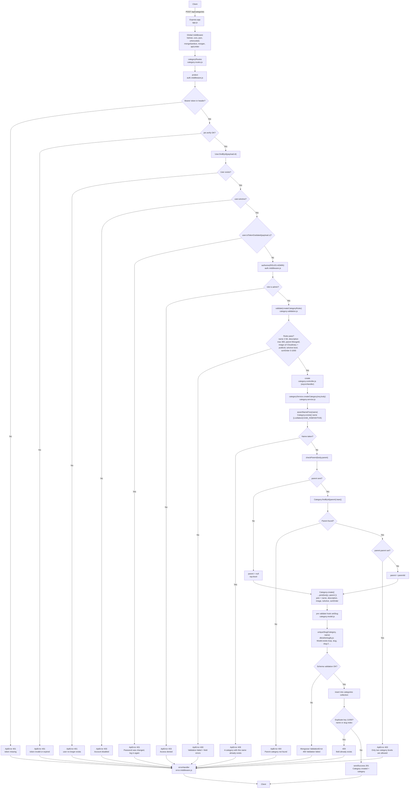

# Create category – `POST /api/categories`

Admin only: creates a top-level category or a sub-category (when `parent` is sent). The slug is never taken from the body; the model builds a unique one from the name.

**Files involved:** `server/src/app.js` (mounts `/api/categories`), `server/src/modules/categories/category.routes.js` (`POST /` with `adminOnly` + `validate`), `server/src/middleware/auth.middleware.js` (`protect`, `authorize`), `server/src/middleware/validate.middleware.js` (`validate`), `server/src/modules/categories/category.validation.js` (`createCategoryRules`), `server/src/modules/categories/category.controller.js` (`create`), `server/src/modules/categories/category.service.js` (`createCategory`, `assertNameFree`, `checkParent`, `pick`), `server/src/modules/categories/category.model.js` (schema, unique indexes, `setSlug` hook), `server/src/db/utils/slugify.js` (`uniqueSlug`, `slugify`), `server/src/db/schemas/image.schema.js` (image sub-document), `server/src/config/constants.js` (`ROLES`, `REGEX`), `server/src/utils/ApiResponse.js` (`sendSuccess`), `server/src/middleware/error.middleware.js` (`errorHandler`).
