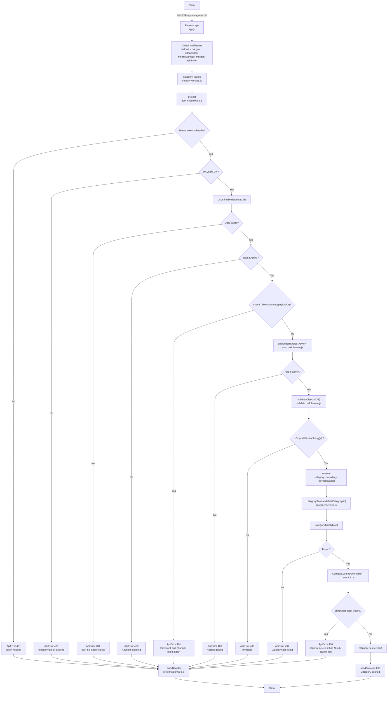

# Delete category – `DELETE /api/categories/:id`

Admin only: permanently deletes a category. It is refused while the category still has sub-categories (they would be left pointing at nothing).

**Files involved:** `server/src/app.js` (mounts `/api/categories`), `server/src/modules/categories/category.routes.js` (`DELETE /:id` with `adminOnly`, `validateObjectId`), `server/src/middleware/auth.middleware.js` (`protect`, `authorize`), `server/src/middleware/validate.middleware.js` (`validateObjectId`), `server/src/modules/categories/category.controller.js` (`remove`), `server/src/modules/categories/category.service.js` (`deleteCategory`), `server/src/modules/categories/category.model.js` (Category model, `parent` index), `server/src/config/constants.js` (`ROLES`), `server/src/utils/ApiResponse.js` (`sendSuccess`), `server/src/middleware/error.middleware.js` (`errorHandler`).
