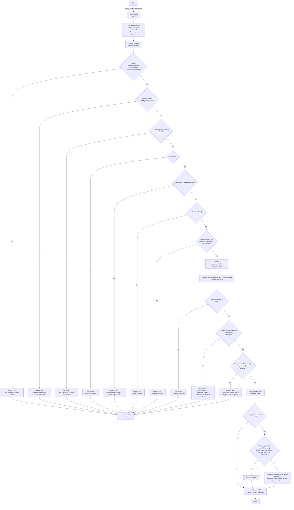

# Delete category – `DELETE /api/categories/:id`

Admin only: permanently deletes a category. Refused while any product still uses it (branch 04) or while it has sub-categories. After the delete, its picture is removed from Cloudinary (branch 04).

**Files involved:** `server/src/app.js` (mounts `/api/categories`, global middleware), `server/src/modules/categories/category.routes.js` (`DELETE /:id` with `protect`, `authorize(ROLES.ADMIN)`, `validateObjectId('id')`), `server/src/middleware/auth.middleware.js` (`protect`, `authorize`), `server/src/middleware/validate.middleware.js` (`validateObjectId`), `server/src/modules/categories/category.controller.js` (`remove`), `server/src/modules/categories/category.service.js` (`deleteCategory`: product check, sub-category check, image cleanup), `server/src/modules/products/product.model.js` (`Product.countDocuments`), `server/src/config/cloudinary.js` (`deleteImage`, `cloudinaryClient.destroy`), `server/src/utils/ApiError.js`, `server/src/utils/ApiResponse.js` (`sendSuccess`), `server/src/middleware/error.middleware.js` (`errorHandler`).
