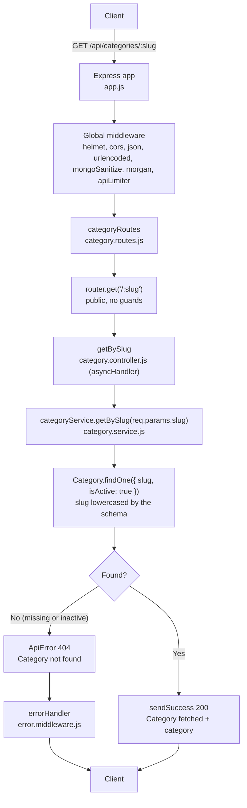

# Get category by slug – `GET /api/categories/:slug`

Public endpoint (no token needed): returns one ACTIVE category found by its readable slug, e.g. `/api/categories/mens-shoes`. A missing category and an inactive one both answer 404.

**Files involved:** `server/src/app.js` (mounts `/api/categories`), `server/src/modules/categories/category.routes.js` (public `GET /:slug`), `server/src/modules/categories/category.controller.js` (`getBySlug`), `server/src/modules/categories/category.service.js` (`getBySlug`, `notFound`), `server/src/modules/categories/category.model.js` (`slug` field with `lowercase: true`), `server/src/utils/ApiError.js` (404), `server/src/utils/ApiResponse.js` (`sendSuccess`), `server/src/middleware/error.middleware.js` (`errorHandler`).
