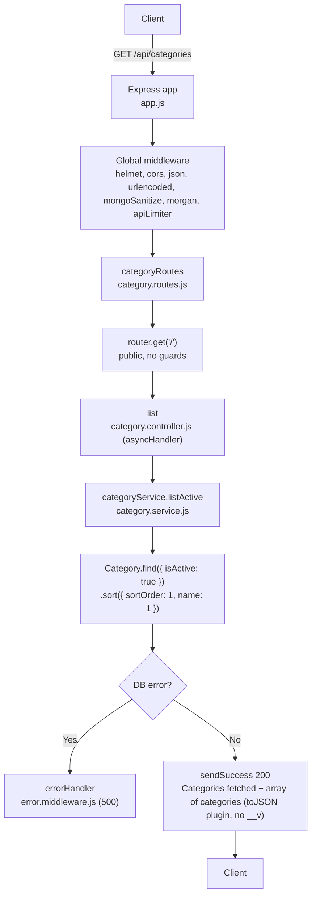

# List categories – `GET /api/categories`

Public endpoint (no token needed): returns every ACTIVE category as one flat list in menu order (`sortOrder`, then `name`). Sub-categories are in the same list and point to their top-level category through `parent`.

**Files involved:** `server/src/app.js` (mounts `/api/categories`, global middleware), `server/src/modules/categories/category.routes.js` (public `GET /`), `server/src/modules/categories/category.controller.js` (`list`), `server/src/modules/categories/category.service.js` (`listActive`, `MENU_ORDER`), `server/src/modules/categories/category.model.js` (Category schema, `toJSON` plugin), `server/src/utils/ApiResponse.js` (`sendSuccess`), `server/src/middleware/error.middleware.js` (`errorHandler`).
