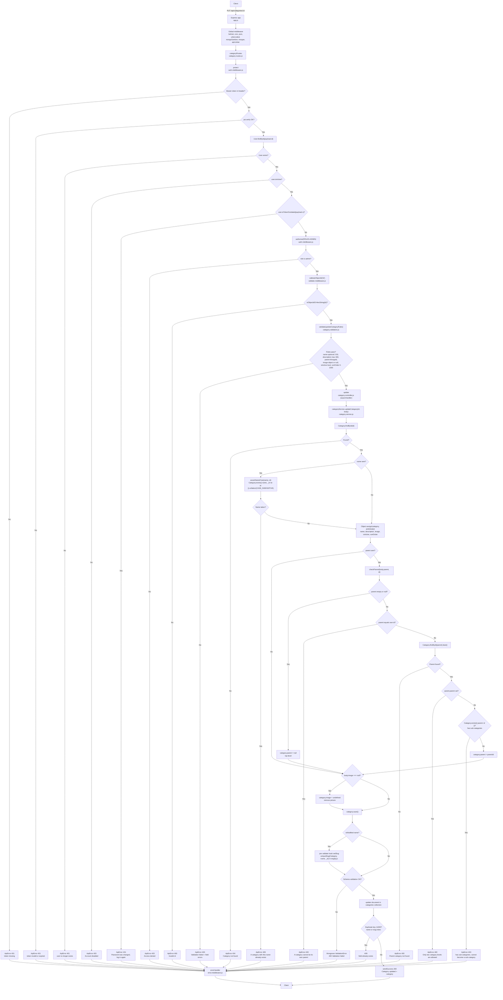

# Update category – `PUT /api/categories/:id`

Admin only: changes any subset of a category's fields (partial update), e.g. `{ "isActive": false }` to switch it off. Renaming also renames the slug; sending `parent` re-checks the two-level rule; `image: null` removes the picture.

**Files involved:** `server/src/app.js` (mounts `/api/categories`), `server/src/modules/categories/category.routes.js` (`PUT /:id` with `adminOnly`, `validateObjectId`, `validate`), `server/src/middleware/auth.middleware.js` (`protect`, `authorize`), `server/src/middleware/validate.middleware.js` (`validateObjectId`, `validate`), `server/src/modules/categories/category.validation.js` (`updateCategoryRules`), `server/src/modules/categories/category.controller.js` (`update`), `server/src/modules/categories/category.service.js` (`updateCategory`, `assertNameFree`, `checkParent`, `pick`), `server/src/modules/categories/category.model.js` (schema, unique indexes, `setSlug` hook), `server/src/db/utils/slugify.js` (`uniqueSlug`), `server/src/db/schemas/image.schema.js` (image sub-document), `server/src/config/constants.js` (`ROLES`, `REGEX`), `server/src/utils/ApiResponse.js` (`sendSuccess`), `server/src/middleware/error.middleware.js` (`errorHandler`).
