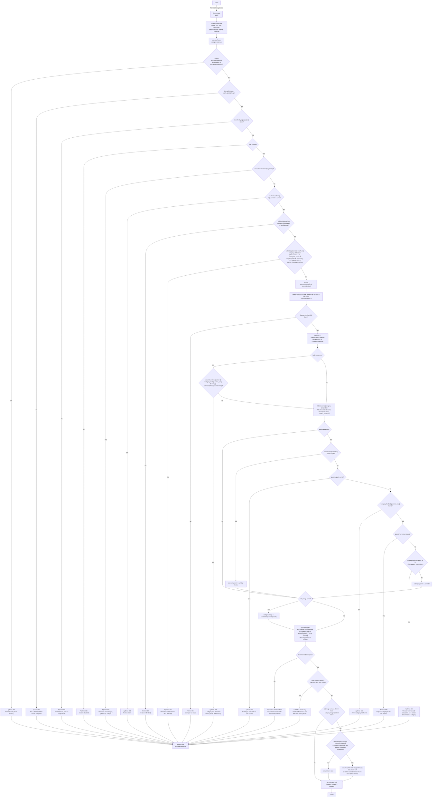

# Update category – `PUT /api/categories/:id`

Admin only: changes any subset of a category's fields (name, description, parent, image, isActive, sortOrder). Renaming rebuilds the slug. From branch 04, when the image is replaced or removed (`image: null`), the old file is deleted from Cloudinary after the save worked.

**Files involved:** `server/src/app.js` (mounts `/api/categories`, global middleware), `server/src/modules/categories/category.routes.js` (`PUT /:id` with `protect`, `authorize(ROLES.ADMIN)`, `validateObjectId('id')`, `validate(updateCategoryRules)`), `server/src/middleware/auth.middleware.js` (`protect`, `authorize`), `server/src/middleware/validate.middleware.js` (`validateObjectId`, `validate`), `server/src/modules/categories/category.validation.js` (`updateCategoryRules`), `server/src/modules/categories/category.controller.js` (`update`), `server/src/modules/categories/category.service.js` (`updateCategory`, `assertNameFree`, `checkParent`, `pick`), `server/src/modules/categories/category.model.js` (`setSlug` hook, `CASE_INSENSITIVE` collation, unique indexes), `server/src/db/utils/slugify.js` (`uniqueSlug`), `server/src/config/cloudinary.js` (`deleteImage`, `cloudinaryClient.destroy`), `server/src/utils/ApiError.js`, `server/src/utils/ApiResponse.js` (`sendSuccess`), `server/src/middleware/error.middleware.js` (`errorHandler`).
