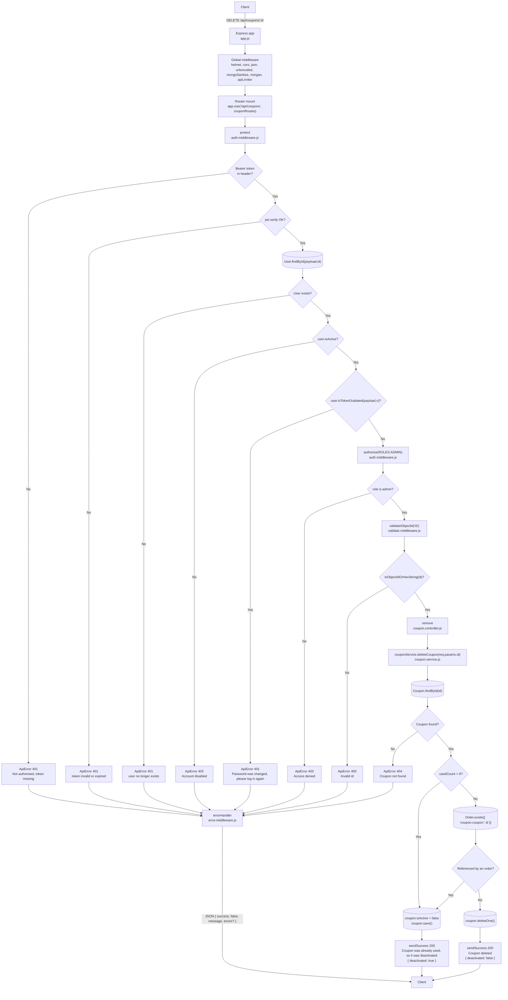

# Delete a coupon (admin) – `DELETE /api/coupons/:id`

An admin deletes a coupon. If it was ever used (`usedCount > 0`) or any order references it (even a cancelled one whose use was released), it is only deactivated so order history never points at a missing coupon. Only admins may call it.

**Files involved:** `server/src/app.js` (global middleware, mounts `/api/coupons`), `server/src/modules/coupons/coupon.routes.js` (route + middleware order), `server/src/middleware/auth.middleware.js` (`protect`, `authorize`), `server/src/middleware/validate.middleware.js` (`validateObjectId`), `server/src/modules/coupons/coupon.controller.js` (`remove`), `server/src/modules/coupons/coupon.service.js` (`deleteCoupon`), `server/src/modules/coupons/coupon.model.js` (schema), `server/src/modules/orders/order.model.js` (`Order.exists` on `coupon.coupon`), `server/src/middleware/error.middleware.js` (error response).
