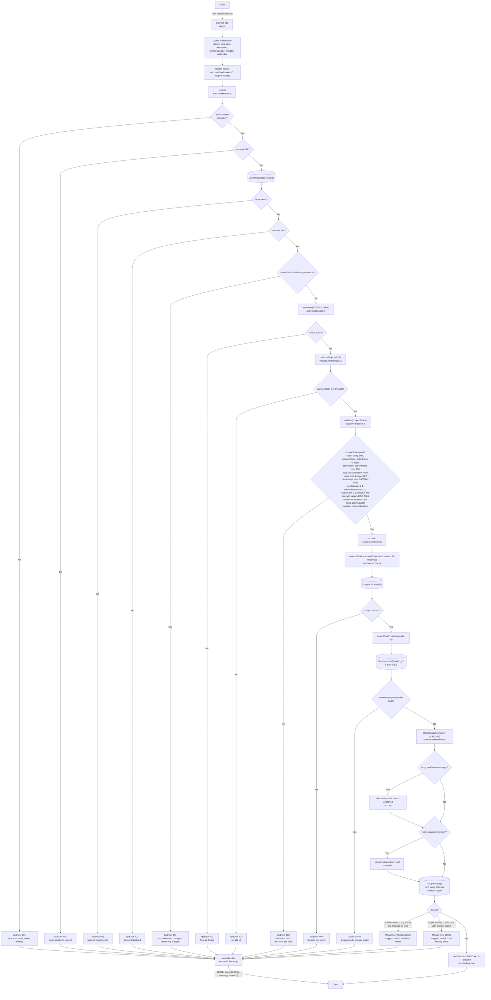

# Update a coupon (admin) – `PUT /api/coupons/:id`

An admin replaces a coupon's settings (the form always sends every field). The code must stay unique among OTHER coupons, only whitelisted fields are copied, an empty `maxDiscount` removes the cap and an empty `usageLimit` makes it unlimited; `usedCount` and `createdBy` can never be changed here. Only admins may call it.

**Files involved:** `server/src/app.js` (global middleware, mounts `/api/coupons`), `server/src/modules/coupons/coupon.routes.js` (route + middleware order), `server/src/middleware/auth.middleware.js` (`protect`, `authorize`), `server/src/middleware/validate.middleware.js` (`validateObjectId`, `validate`), `server/src/modules/coupons/coupon.validation.js` (`couponRules`), `server/src/config/constants.js` (`REGEX.COUPON_CODE`, `COUPON_TYPES`, `LIMITS.COUPON_MAX_PERCENT`, `LIMITS.COUPON_MAX_FIXED`), `server/src/modules/coupons/coupon.controller.js` (`update`), `server/src/modules/coupons/coupon.service.js` (`updateCoupon`, `assertCodeFree`, `pick`), `server/src/modules/coupons/coupon.model.js` (schema validators, unique index on `code`), `server/src/middleware/error.middleware.js` (ValidationError to 400, 11000 to 409, error response).
