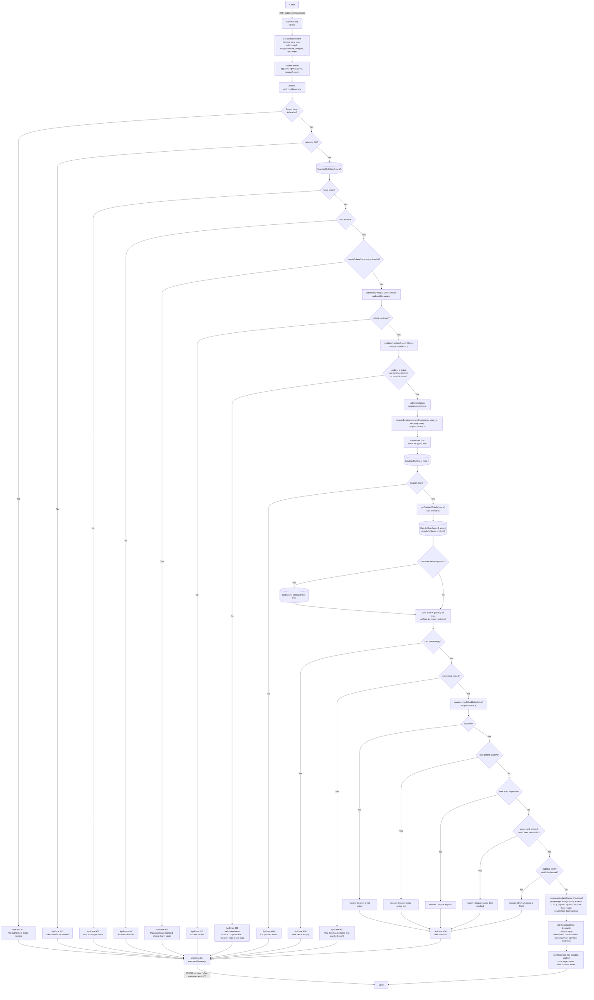

# Validate (preview) a coupon on my cart – `POST /api/coupons/validate`

A logged-in customer sends a coupon code and gets back the discount and the new totals for their CURRENT cart, calculated on the server from today's product prices. It is only a preview: the coupon is not used up (`usedCount` is not changed). Admins get 403 because they have no cart.

**Files involved:** `server/src/app.js` (global middleware, mounts `/api/coupons`), `server/src/modules/coupons/coupon.routes.js` (route + middleware order), `server/src/middleware/auth.middleware.js` (`protect`, `authorize`), `server/src/middleware/validate.middleware.js` (`validate`), `server/src/modules/coupons/coupon.validation.js` (`validateCouponRules`), `server/src/modules/coupons/coupon.controller.js` (`validateCoupon`), `server/src/modules/coupons/coupon.service.js` (`previewCoupon`, `normalizeCode`), `server/src/modules/coupons/coupon.model.js` (`checkUsable`, `calculateDiscount`), `server/src/modules/cart/cart.service.js` (`getCartWithTotals`), `server/src/modules/cart/cart.model.js` (`Cart.forUser`), `server/src/utils/pricing.js` (`calcTotals`), `server/src/middleware/error.middleware.js` (error response).
