# Seed demo data – `npm run seed`

A developer fills an empty database with demo data: the admin account (from `ADMIN_*` in `.env`), 14 categories (5 main + 9 sub), 30 products with Cloudinary demo images and 2 coupons (`WELCOME10`, `FLAT500`). It is idempotent: each record is looked up by a natural key (email, name, SKU, code) and only created when missing, so a re-run changes nothing. It refuses to turn an existing customer into an admin. Not an HTTP endpoint.

```mermaid
flowchart TD
    A["Developer<br/>npm run seed"] --> B["node src/db/scripts/seed.js<br/>package.json script"]
    B --> EN["import env.js<br/>dotenv.config, read .env"]
    EN --> EN1{"MONGO_URI and JWT_SECRET set?"}
    EN1 -->|No| X0["console.error Missing required environment variables<br/>process.exit(1)"]
    EN1 -->|Yes| M0{"isMain?<br/>process.argv[1] is this file"}
    M0 -->|"No, imported by tests/integration/seed.test.js"| T0["only seedStore() is exported<br/>the test opens its own connection"]
    M0 -->|Yes| C1[("mongoose.connect(env.MONGO_URI)")]
    C1 -.->|"connect fails, outside try"| X2["top-level await rejects<br/>process crashes with an error"]
    C1 --> S0["seedStore()<br/>created = admin false, categories 0, products 0, coupons 0"]
    S0 --> A1[("seedAdmin()<br/>User.findOne({ email: env.ADMIN_EMAIL })")]
    A1 --> A2{"exists AND role is not admin?"}
    A2 -->|Yes| X1["throw Error<br/>email belongs to a CUSTOMER account, use another ADMIN_EMAIL"]
    A2 -->|No| A3{admin exists?}
    A3 -->|Yes| A5["admin = existing, created false"]
    A3 -->|No| A4[("new User(ADMIN_NAME, ADMIN_EMAIL, ADMIN_PASSWORD,<br/>role admin, isEmailVerified true).save()<br/>pre-save hook hashes the password")]
    A4 --> A5b["created.admin = true"]
    A5 --> K1
    A5b --> K1["for each of 5 MAIN_CATEGORIES<br/>name, description, sortOrder"]
    K1 --> K2[("findOrCreateCategory<br/>Category.findOne({ name })<br/>missing: Category.create, hooks build slug + depth check")]
    K2 --> K3["for each of 9 SUB_CATEGORIES<br/>parent = main category _id"]
    K3 --> K4[("findOrCreateCategory(name, description, parent)")]
    K4 --> K5["byKey map: sub keys + MAIN_KEYS sports, toys"]
    K5 --> P1["for each of 30 PRODUCTS"]
    P1 --> P2[("Product.exists({ sku })")]
    P2 --> P3{SKU already there?}
    P3 -->|"Yes, skip, leave untouched"| P1N{more products?}
    P3 -->|No| P4[("Product.create<br/>name, brand, sku, price, stock, isFeatured,<br/>compareAtPrice or undefined, description,<br/>category from byKey, Cloudinary demo image,<br/>specifications, createdBy admin")]
    P4 --> P1N
    P1N -->|Yes| P1
    P1N -->|No| Q1["for each coupon WELCOME10, FLAT500"]
    Q1 --> Q2[("Coupon.exists({ code })")]
    Q2 --> Q3{code already there?}
    Q3 -->|"Yes, skip"| Q1N{more coupons?}
    Q3 -->|No| Q4[("Coupon.create<br/>expiresAt = now + 90 days,<br/>createdBy admin")]
    Q4 --> Q1N
    Q1N -->|Yes| Q1
    Q1N -->|No| S1["return created counts<br/>all 0 on a second run, idempotent"]
    S1 --> L1["console.log<br/>Admin created or already existed,<br/>categories new, products new + already existed,<br/>coupons new, Seed complete"]
    L1 --> F1
    X1 --> CE["catch: console.error Seed failed + message<br/>process.exitCode = 1"]
    K2 -.->|"any thrown error, e.g. validation"| CE
    P4 -.->|"any thrown error"| CE
    Q4 -.->|"any thrown error"| CE
    CE --> F1[("finally: mongoose.disconnect()")]
    F1 --> Z["process ends<br/>exit code 0, or 1 after an error"]
```

**Files involved:** `server/package.json` (`seed` script), `server/src/db/scripts/seed.js` (`seedStore`, `seedAdmin`, `findOrCreateCategory`, `MAIN_CATEGORIES`, `SUB_CATEGORIES`, `PRODUCTS`), `server/src/config/env.js` (`MONGO_URI`, `ADMIN_NAME`, `ADMIN_EMAIL`, `ADMIN_PASSWORD`), `server/src/config/constants.js` (`ROLES`, `COUPON_TYPES`), `server/src/modules/models.js` (`User`, `Category`, `Product`, `Coupon`), `server/src/modules/users/user.model.js` (password hashing hook), `server/src/modules/categories/category.model.js` (slug + depth hooks), `server/tests/integration/seed.test.js` (imports `seedStore`).
