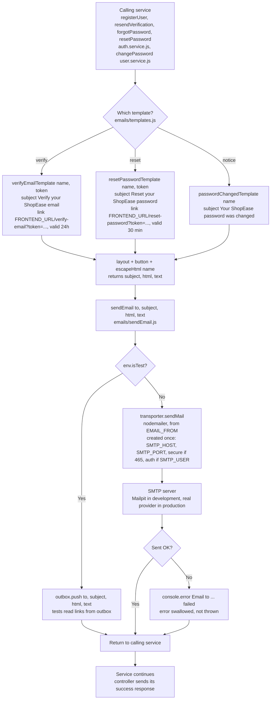

# Send email – internal helper `sendEmail()`

The one shared function every service uses to send an email (verification, password reset, password changed). It is not an HTTP endpoint: services call it after their database work succeeds. Email failures are logged, never thrown, so a broken mail server never fails the request.

**Files involved:** `server/src/emails/sendEmail.js` (sendEmail, nodemailer transporter, test outbox and clearOutbox), `server/src/emails/templates.js` (verifyEmailTemplate, resetPasswordTemplate, passwordChangedTemplate, layout, button, escapeHtml), `server/src/config/env.js` (SMTP_*, EMAIL_FROM, FRONTEND_URL, isTest), `server/src/modules/auth/auth.service.js` (callers: registerUser, resendVerification, forgotPassword, resetPassword), `server/src/modules/users/user.service.js` (caller: changePassword).
