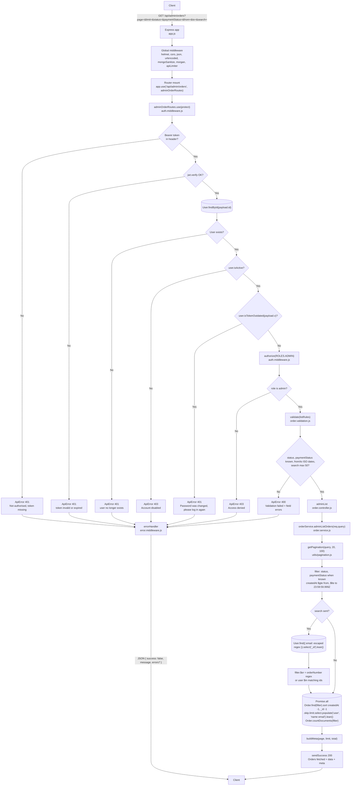

# List all orders (admin) – `GET /api/admin/orders`

An admin lists every order, newest first, paginated (default 20, max 100), filtered by status, payment status, a date range and a search on order number or customer email. Only admins may call it.

**Files involved:** `server/src/app.js` (global middleware, mounts `/api/admin/orders`), `server/src/modules/orders/order.routes.js` (`adminOrderRoutes` + middleware order), `server/src/middleware/auth.middleware.js` (`protect`, `authorize`), `server/src/middleware/validate.middleware.js` (`validate`), `server/src/modules/orders/order.validation.js` (`listRules`), `server/src/modules/orders/order.controller.js` (`adminList`), `server/src/modules/orders/order.service.js` (`adminListOrders`, `escapeRegex`), `server/src/utils/pagination.js` (`getPagination`, `buildMeta`), `server/src/modules/orders/order.model.js` (schema, indexes), `server/src/middleware/error.middleware.js` (error response).
