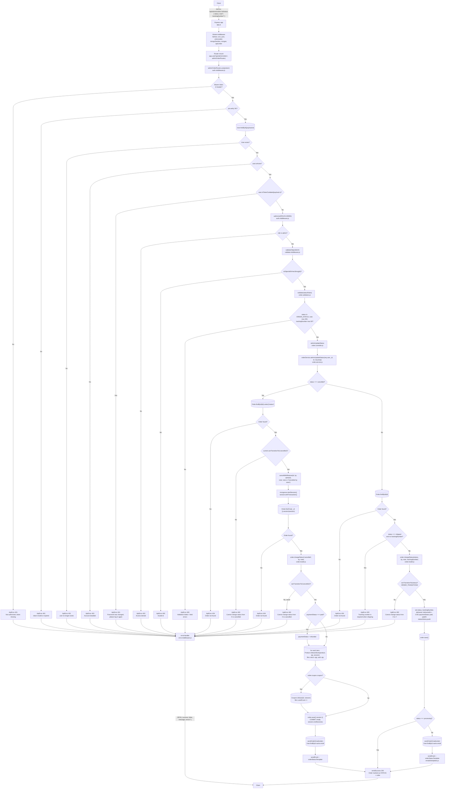

# Update order status (admin) – `PATCH /api/admin/orders/:id/status`

An admin moves an order along the state machine (BR-08): pending → confirmed → processing → shipped → delivered, or to cancelled before shipping. Cancelling restores stock and the coupon use in a transaction; shipping needs a tracking number; delivering a COD order marks it paid. Only admins may call it.

**Files involved:** `server/src/app.js` (global middleware, mounts `/api/admin/orders`), `server/src/modules/orders/order.routes.js` (`adminOrderRoutes` + middleware order), `server/src/middleware/auth.middleware.js` (`protect`, `authorize`), `server/src/middleware/validate.middleware.js` (`validateObjectId`, `validate`), `server/src/modules/orders/order.validation.js` (`statusRules`), `server/src/modules/orders/order.controller.js` (`adminUpdateStatus`), `server/src/modules/orders/order.service.js` (`adminUpdateStatus`, `cancelWithRestore`, `sendOrderEmail`), `server/src/modules/orders/order.model.js` (`canTransitionTo`, `changeStatus`), `server/src/config/constants.js` (`ORDER_STATUS`, `ORDER_TRANSITIONS`), `server/src/modules/products/product.model.js` (`releaseStock`), `server/src/modules/coupons/coupon.model.js` (`release`), `server/src/emails/sendEmail.js` + `server/src/emails/templates.js` (`orderStatusTemplate`), `server/src/middleware/error.middleware.js` (error response).
