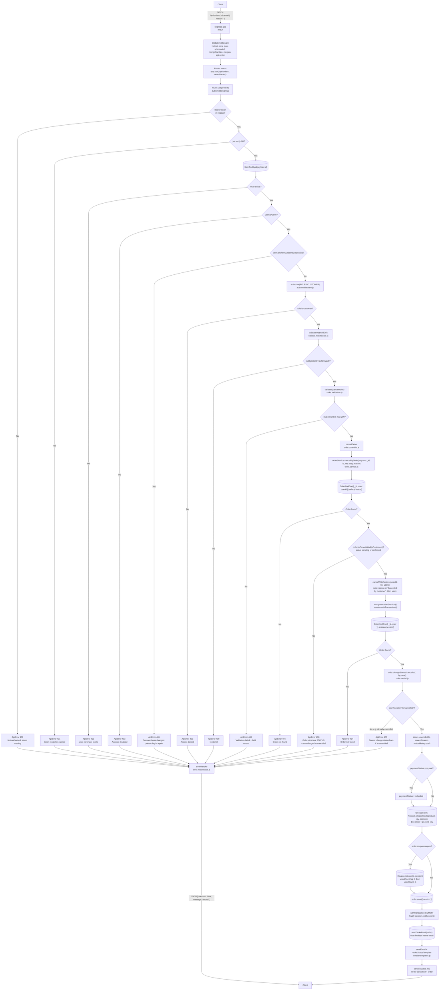

# Cancel my order – `PATCH /api/orders/:id/cancel`

A customer cancels their own order while it is still `pending` or `confirmed` (BR-06). In one transaction the order becomes `cancelled`, every unit goes back into stock and the coupon use is released, then the customer is emailed.

**Files involved:** `server/src/app.js` (global middleware, mounts `/api/orders`), `server/src/modules/orders/order.routes.js` (route + middleware order), `server/src/middleware/auth.middleware.js` (`protect`, `authorize`), `server/src/middleware/validate.middleware.js` (`validateObjectId`, `validate`), `server/src/modules/orders/order.validation.js` (`cancelRules`), `server/src/modules/orders/order.controller.js` (`cancelOrder`), `server/src/modules/orders/order.service.js` (`cancelMyOrder`, `cancelWithRestore`, `sendOrderEmail`), `server/src/modules/orders/order.model.js` (`isCancellableByCustomer`, `canTransitionTo`, `changeStatus`), `server/src/config/constants.js` (`CUSTOMER_CANCELLABLE`, `ORDER_TRANSITIONS`), `server/src/modules/products/product.model.js` (`releaseStock`), `server/src/modules/coupons/coupon.model.js` (`release`), `server/src/emails/sendEmail.js` + `server/src/emails/templates.js` (`orderStatusTemplate`), `server/src/middleware/error.middleware.js` (error response).
