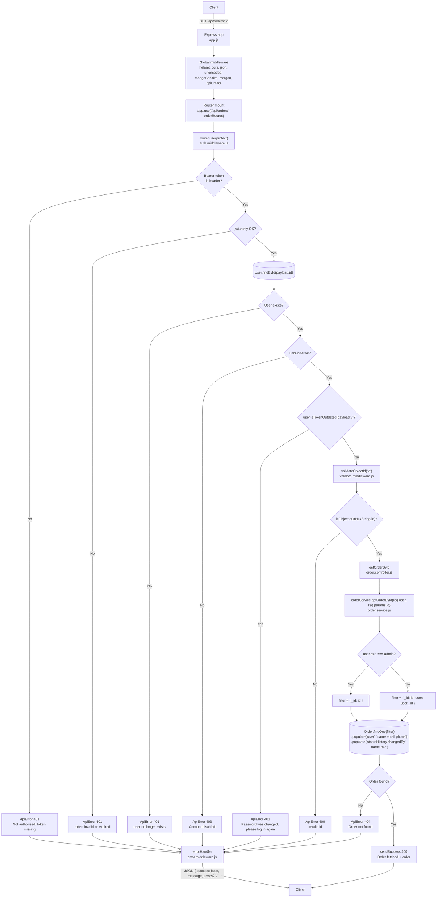

# Get one order – `GET /api/orders/:id`

Reads one full order. The owner (customer) or any admin may call it; there is no `authorize()` on the route, the service decides. Another customer's order answers 404, never 403, so ids leak nothing.

**Files involved:** `server/src/app.js` (global middleware, mounts `/api/orders`), `server/src/modules/orders/order.routes.js` (route + middleware order), `server/src/middleware/auth.middleware.js` (`protect`), `server/src/middleware/validate.middleware.js` (`validateObjectId`), `server/src/modules/orders/order.controller.js` (`getOrderById`), `server/src/modules/orders/order.service.js` (`getOrderById`, ownership filter), `server/src/modules/orders/order.model.js` (schema), `server/src/middleware/error.middleware.js` (error response).
