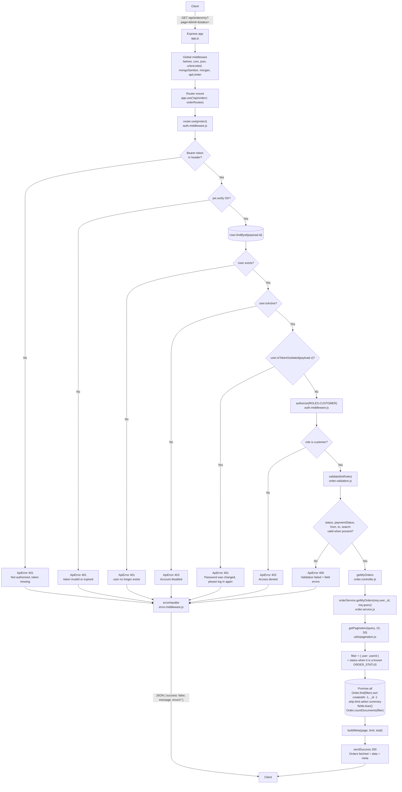

# List my orders – `GET /api/orders/my`

A logged-in customer reads their own orders, newest first, paginated (default 10, max 50) with an optional `?status=` filter. Only customers may call it.

**Files involved:** `server/src/app.js` (global middleware, mounts `/api/orders`), `server/src/modules/orders/order.routes.js` (route + middleware order, `/my` declared before `/:id`), `server/src/middleware/auth.middleware.js` (`protect`, `authorize`), `server/src/middleware/validate.middleware.js` (`validate`), `server/src/modules/orders/order.validation.js` (`listRules`), `server/src/modules/orders/order.controller.js` (`getMyOrders`), `server/src/modules/orders/order.service.js` (`getMyOrders`), `server/src/utils/pagination.js` (`getPagination`, `buildMeta`), `server/src/modules/orders/order.model.js` (schema, `user + createdAt` index), `server/src/middleware/error.middleware.js` (error response).
