# Place an order (checkout) – `POST /api/orders`

A logged-in customer with a verified email turns their cart into an order. The server reads the cart, products, address and coupon from the database, reserves stock, consumes the coupon, creates the order and empties the cart inside ONE MongoDB transaction, then emails a confirmation for COD orders.

```mermaid
flowchart TD
    A[Client] -->|"POST /api/orders { addressId, paymentMethod?, couponCode?, note? }"| B[Express app<br/>app.js]
    B --> C[Global middleware<br/>helmet, cors, json, urlencoded, mongoSanitize, morgan, apiLimiter]
    C --> D["Router mount<br/>app.use('/api/orders', orderRoutes)"]
    D --> P1["router.use(protect)<br/>auth.middleware.js"]
    P1 --> P2{"Bearer token<br/>in header?"}
    P2 -->|No| E1["ApiError 401<br/>Not authorised, token missing"]
    P2 -->|Yes| P3{"jwt.verify OK?"}
    P3 -->|No| E2["ApiError 401<br/>token invalid or expired"]
    P3 -->|Yes| P4[("User.findById(payload.id)")]
    P4 --> P5{User exists?}
    P5 -->|No| E3["ApiError 401<br/>user no longer exists"]
    P5 -->|Yes| P6{user.isActive?}
    P6 -->|No| E4["ApiError 403<br/>Account disabled"]
    P6 -->|Yes| P7{"user.isTokenOutdated(payload.v)?"}
    P7 -->|Yes| E5["ApiError 401<br/>Password was changed, please log in again"]
    P7 -->|No| Z1["authorize(ROLES.CUSTOMER)<br/>auth.middleware.js"]
    Z1 --> Z2{role is customer?}
    Z2 -->|No| E6["ApiError 403<br/>Access denied"]
    Z2 -->|Yes| V1["requireVerifiedEmail<br/>auth.middleware.js"]
    V1 --> V2{"isEmailVerified?"}
    V2 -->|No| E7["ApiError 403<br/>Please verify your email address to continue"]
    V2 -->|Yes| VA["validate(placeOrderRules)<br/>order.validation.js"]
    VA --> VB{"addressId is MongoId, paymentMethod in COD/CARD,<br/>couponCode max 20, note max 300?"}
    VB -->|No| E8["ApiError 400<br/>Validation failed + field errors"]
    VB -->|Yes| CT["placeOrder<br/>order.controller.js"]
    CT --> S1["orderService.placeOrder(req.user._id, req.body)<br/>order.service.js"]
    S1 --> S2["paymentMethod = body.paymentMethod or COD"]
    S2 --> S3{"CARD and not env.PAYMENT_CARD_ENABLED?"}
    S3 -->|Yes| E9["ApiError 400<br/>Card payments are not available right now"]
    S3 -->|No| Q1["placeOrderOnce(userId, body)"]
    Q1 --> Q2[("Address.findOne({ _id: addressId, user: userId })")]
    Q2 --> Q3{Address found?}
    Q3 -->|No| E10["ApiError 404<br/>Address not found"]
    Q3 -->|Yes| T0["mongoose.startSession()<br/>session.withTransaction()"]
    T0 --> T1[("Cart.findOne({ user }).populate('items.product').session(session)")]
    T1 --> T2{"Cart exists and has items?"}
    T2 -->|No| E11["ApiError 400<br/>Your cart is empty"]
    T2 -->|Yes| L1["for each cart line"]
    L1 --> L2{"product exists and isActive?"}
    L2 -->|No| LP["problems.push<br/>no longer available"]
    L2 -->|Yes| L3{"quantity over LIMITS.MAX_CART_QTY?"}
    L3 -->|Yes| LP2["problems.push<br/>at most MAX_CART_QTY of one product"]
    L3 -->|No| L4[("Product.reserveStock(id, qty, session)<br/>updateOne stock $gte qty, $inc stock -qty, sold +qty")]
    L4 --> L5{"modifiedCount === 1?"}
    L5 -->|No| LP3["problems.push<br/>Only N left in stock"]
    L5 -->|Yes| L6["items.push snapshot<br/>name, slug, sku, image, price, quantity, subtotal"]
    LP --> L7{"problems.length?"}
    LP2 --> L7
    LP3 --> L7
    L6 --> L7
    L7 -->|Yes| E12["ApiError 409<br/>Some items in your cart are unavailable + problems<br/>transaction aborts, reserved stock undone"]
    L7 -->|No| M1["itemsPrice = sum of subtotals"]
    M1 --> K1{couponCode sent?}
    K1 -->|No| PR["calcTotals(itemsPrice, discount)<br/>utils/pricing.js"]
    K1 -->|Yes| K2[("Coupon.findOne({ code: UPPERCASE }).session(session)")]
    K2 --> K3{Coupon found?}
    K3 -->|No| E13["ApiError 400<br/>Coupon not found"]
    K3 -->|Yes| K4{"coupon.checkUsable(itemsPrice).ok?"}
    K4 -->|No| E14["ApiError 400<br/>check.reason: not active, expired,<br/>limit reached, minimum order"]
    K4 -->|Yes| K5[("Coupon.consume(id, session)<br/>updateOne under limit, $inc usedCount +1")]
    K5 --> K6{"modifiedCount === 1?"}
    K6 -->|No| E15["ApiError 400<br/>Coupon usage limit reached"]
    K6 -->|Yes| K7["discount = coupon.calculateDiscount(itemsPrice)<br/>couponSnapshot"]
    K7 --> PR
    PR --> O1[("Order.create([order], { session })<br/>items, shippingAddress: address.toSnapshot(), coupon, totals, note")]
    O1 --> O2["pre validate hook order.model.js<br/>orderNumber ORD-yyyymmdd-random, totals check,<br/>statusHistory 'Order placed'"]
    O2 --> O3[("cart.items = [] then cart.save({ session })")]
    O3 --> O4["withTransaction COMMIT<br/>finally session.endSession()"]
    O4 --> DUP{"Error 11000 on orderNumber?"}
    DUP -->|"Yes, rolled back"| RT["placeOrderOnce again, one retry"]
    RT --> O5
    DUP -->|No| O5{"paymentMethod === COD?"}
    O5 -->|Yes| EM1[("sendOrderEmail(order, 'confirmation')<br/>User.findById name email")]
    EM1 --> EM2["sendEmail + orderConfirmationTemplate<br/>emails/templates.js"]
    EM2 --> OK
    O5 -->|No| OK["sendSuccess 201<br/>Order placed successfully + order"]
    OK --> R[Client]
    E1 --> EH["errorHandler<br/>error.middleware.js"]
    E2 --> EH
    E3 --> EH
    E4 --> EH
    E5 --> EH
    E6 --> EH
    E7 --> EH
    E8 --> EH
    E9 --> EH
    E10 --> EH
    E11 --> EH
    E12 --> EH
    E13 --> EH
    E14 --> EH
    E15 --> EH
    EH -->|"JSON { success: false, message, errors? }"| R
```

Any `ApiError` thrown inside `withTransaction` aborts the transaction, so every stock reservation, coupon use and cart change made so far is undone before the error reaches `errorHandler`.

**Files involved:** `server/src/app.js` (global middleware, mounts `/api/orders`), `server/src/modules/orders/order.routes.js` (route + middleware order), `server/src/middleware/auth.middleware.js` (`protect`, `authorize`, `requireVerifiedEmail`), `server/src/middleware/validate.middleware.js` (`validate`), `server/src/modules/orders/order.validation.js` (`placeOrderRules`), `server/src/modules/orders/order.controller.js` (`placeOrder`), `server/src/modules/orders/order.service.js` (`placeOrder`, `placeOrderOnce`, `sendOrderEmail`), `server/src/modules/orders/order.model.js` (schema, pre-validate hook), `server/src/modules/addresses/address.model.js` (`toSnapshot`), `server/src/modules/products/product.model.js` (`reserveStock`), `server/src/modules/coupons/coupon.model.js` (`checkUsable`, `consume`, `calculateDiscount`), `server/src/utils/pricing.js` (`calcTotals`), `server/src/config/env.js` (`PAYMENT_CARD_ENABLED`), `server/src/emails/sendEmail.js` + `server/src/emails/templates.js` (`orderConfirmationTemplate`), `server/src/middleware/error.middleware.js` (error response).
