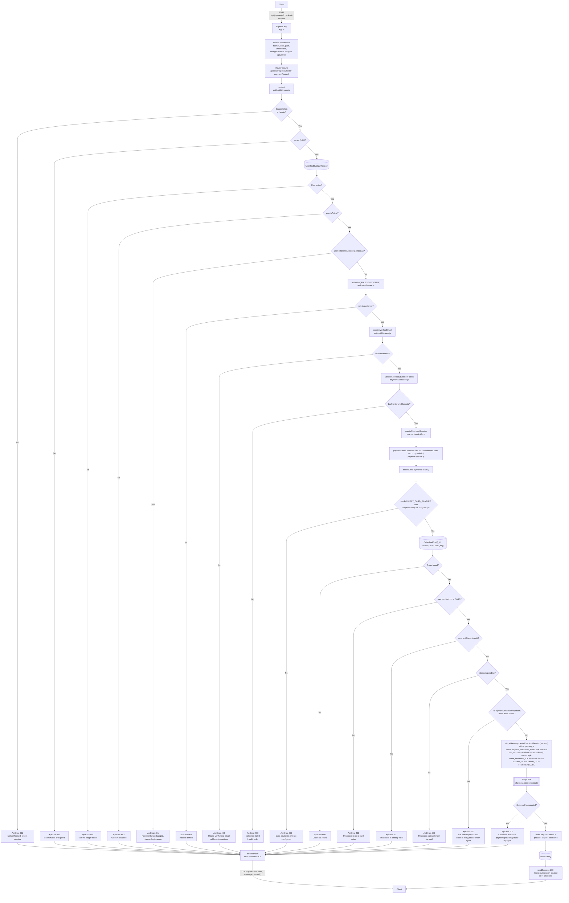

# Create a Stripe checkout session – `POST /api/payments/checkout-session`

A logged-in customer with a verified email sends the id of one of their own CARD orders and gets back the URL of a Stripe-hosted payment page. The amount is never taken from the client: the server reads `totalPrice` from the order. Admins get 403, and the route answers 400 while card payments are switched off.

**Files involved:** `server/src/app.js` (global middleware, mounts `/api/payments`), `server/src/modules/payments/payment.routes.js` (route + middleware order), `server/src/middleware/auth.middleware.js` (`protect`, `authorize`, `requireVerifiedEmail`), `server/src/middleware/validate.middleware.js` (`validate`), `server/src/modules/payments/payment.validation.js` (`checkoutSessionRules`), `server/src/modules/payments/payment.controller.js` (`createCheckoutSession`), `server/src/modules/payments/payment.service.js` (`createCheckoutSession`, `assertCardPaymentsReady`, `isPaymentWindowOver`, `toMinorUnits`), `server/src/modules/payments/stripe.gateway.js` (`isConfigured`, `createCheckoutSession`), `server/src/config/env.js` (`PAYMENT_CARD_ENABLED`, `STRIPE_SECRET_KEY`, `FRONTEND_URL`), `server/src/config/constants.js` (`PAYMENTS`, `PAYMENT_METHODS`, `PAYMENT_STATUS`, `ORDER_STATUS`), `server/src/middleware/error.middleware.js` (error response).
