# Expire unpaid card orders (cron job) – `GET /api/payments/expire-unpaid` and `POST /api/payments/expire-unpaid`

Called by a scheduler (Vercel Cron in `server/vercel.json`, daily at 03:00, using GET), not by a user. The caller proves itself with the shared `CRON_SECRET`. The job cancels every CARD order that is still unpaid and pending after 30 minutes and gives its stock and coupon use back.

```mermaid
flowchart TD
    A[Scheduler / Vercel Cron] -->|"GET or POST /api/payments/expire-unpaid"| B[Express app<br/>app.js]
    B --> C[Global middleware<br/>helmet, cors, json, urlencoded, mongoSanitize, morgan, apiLimiter]
    C --> D["Router mount<br/>app.use('/api/payments', paymentRoutes)"]
    D --> K1["requireCronSecret<br/>cron.middleware.js"]
    K1 --> K2["sent = x-cron-secret header<br/>or the Authorization Bearer value"]
    K2 --> K3{secret sent?}
    K3 -->|No| E1["ApiError 401<br/>Cron secret missing"]
    K3 -->|Yes| K4{"env.CRON_SECRET set and<br/>safeEqual(sent, CRON_SECRET)?<br/>crypto.timingSafeEqual"}
    K4 -->|No| E2["ApiError 403<br/>Invalid cron secret"]
    K4 -->|Yes| CT["expireUnpaid<br/>payment.controller.js"]
    CT --> S0["paymentService.expireUnpaidOrders()<br/>payment.service.js"]
    S0 --> S1["cutoff = now minus UNPAID_CARD_EXPIRY_MS<br/>30 minutes"]
    S1 --> S2[("Order.find paymentMethod CARD,<br/>paymentStatus pending, status pending,<br/>createdAt before cutoff<br/>.select('_id').lean()")]
    S2 --> L1{"next stale order id?"}
    L1 -->|No more| OK["sendSuccess 200 Expired unpaid card orders<br/>checked, cancelled, skipped"]
    L1 -->|Yes| CW["cancelWithRestore(_id,<br/>note Payment not completed in time,<br/>filter paymentStatus pending + status pending)<br/>order.service.js"]
    CW --> T1[("mongoose.startSession<br/>session.withTransaction")]
    T1 --> T2[("Order.findOne({ _id, ...filter }).session(session)")]
    T2 --> T3{"Found?<br/>the webhook may have paid it meanwhile"}
    T3 -->|No| F1["throw ApiError 404<br/>Order not found"]
    T3 -->|Yes| T4["order.changeStatus(CANCELLED, note)<br/>order.model.js"]
    T4 --> T5{Transition allowed?}
    T5 -->|No| F2["throw ApiError 400<br/>Cannot change status from X to cancelled"]
    T5 -->|Yes| T6{"paymentStatus is paid?"}
    T6 -->|Yes| T7["paymentStatus = refunded"]
    T6 -->|No| T8
    T7 --> T8[("Product.releaseStock per item<br/>$inc stock +qty, sold -qty")]
    T8 --> T9{"order.coupon set?"}
    T9 -->|Yes| T10[("Coupon.release(couponId)<br/>$inc usedCount -1")]
    T9 -->|No| T11
    T10 --> T11[("order.save(session)<br/>commit transaction")]
    T11 --> T12["sendOrderEmail(order)<br/>sendEmail + orderStatusTemplate"]
    T12 --> C1["cancelled += 1"]
    F1 --> C2["catch: console.error<br/>skipped += 1"]
    F2 --> C2
    C1 --> L1
    C2 --> L1
    OK --> R[Scheduler]
    E1 --> EH["errorHandler<br/>error.middleware.js"]
    E2 --> EH
    EH -->|"JSON { success: false, message }"| R
```

**Files involved:** `server/vercel.json` (cron schedule `0 3 * * *`), `server/src/app.js` (global middleware, mounts `/api/payments`), `server/src/modules/payments/payment.routes.js` (GET and POST routes), `server/src/modules/payments/cron.middleware.js` (`requireCronSecret`, `safeEqual`), `server/src/modules/payments/payment.controller.js` (`expireUnpaid`), `server/src/modules/payments/payment.service.js` (`expireUnpaidOrders`), `server/src/modules/orders/order.service.js` (`cancelWithRestore`, `sendOrderEmail`), `server/src/modules/orders/order.model.js` (`changeStatus`), `server/src/modules/products/product.model.js` (`releaseStock`), `server/src/modules/coupons/coupon.model.js` (`release`), `server/src/config/env.js` (`CRON_SECRET`), `server/src/config/constants.js` (`PAYMENTS.UNPAID_CARD_EXPIRY_MS`), `server/src/middleware/error.middleware.js` (error response).
