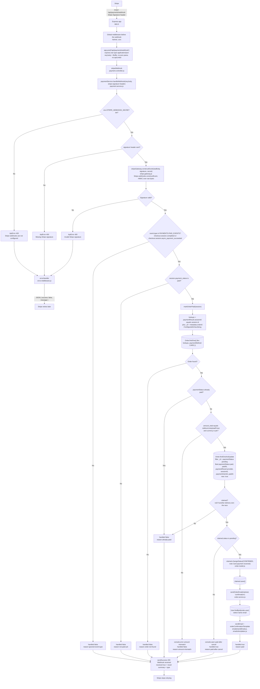

# Stripe webhook (payment confirmed) – `POST /api/payments/webhook`

Called by Stripe, not by a browser. The route is registered directly in `app.js` BEFORE `express.json()` and the rate limiter, so the body stays the exact raw bytes Stripe signed. After the signature check, a paid Checkout Session marks the matching CARD order as paid (atomic and idempotent) and confirms it; every other correctly signed event is acknowledged with 200 and ignored.

**Files involved:** `server/src/app.js` (registers the webhook with `express.raw()` before `express.json()` and `apiLimiter`), `server/src/modules/payments/payment.controller.js` (`stripeWebhook`), `server/src/modules/payments/payment.service.js` (`handleWebhook`, `markOrderPaid`, `toMinorUnits`), `server/src/modules/payments/stripe.gateway.js` (`constructEvent`), `server/src/modules/orders/order.model.js` (`changeStatus`), `server/src/modules/orders/order.service.js` (`sendOrderEmail`), `server/src/emails/sendEmail.js` + `server/src/emails/templates.js` (`orderConfirmationTemplate`), `server/src/config/env.js` (`STRIPE_WEBHOOK_SECRET`), `server/src/config/constants.js` (`PAYMENTS.PAID_EVENTS`, `PAYMENTS.CURRENCY`, `PAYMENT_STATUS`, `ORDER_STATUS`), `server/src/middleware/error.middleware.js` (error response).
