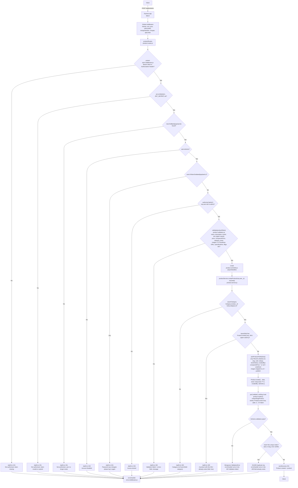

# Create product – `POST /api/products`

Admin only: creates a product from a JSON body (images are `{ url, publicId }` pairs returned earlier by `POST /api/uploads/image`). The slug is generated from the name, `createdBy` comes from the token, and `stock` is accepted here only as the starting stock (default 0).

**Files involved:** `server/src/app.js` (mounts `/api/products`, global middleware), `server/src/modules/products/product.routes.js` (`POST /` with `protect`, `authorize(ROLES.ADMIN)`, `validate(productRules)`), `server/src/middleware/auth.middleware.js` (`protect`, `authorize`), `server/src/middleware/validate.middleware.js` (`validate`), `server/src/modules/products/product.validation.js` (`productRules`), `server/src/modules/products/product.controller.js` (`create`), `server/src/modules/products/product.service.js` (`createProduct`, `assertCategory`, `assertSkuFree`, `pickProductFields`, `FIELDS`), `server/src/modules/products/product.model.js` (schema validators, `setSlug` hook, unique `sku`/`slug`), `server/src/db/utils/slugify.js` (`uniqueSlug`), `server/src/config/constants.js` (`REGEX.SKU`, `REGEX.CLOUDINARY_URL`, `LIMITS`), `server/src/utils/ApiError.js`, `server/src/utils/ApiResponse.js` (`sendSuccess`), `server/src/middleware/error.middleware.js` (`errorHandler`).
