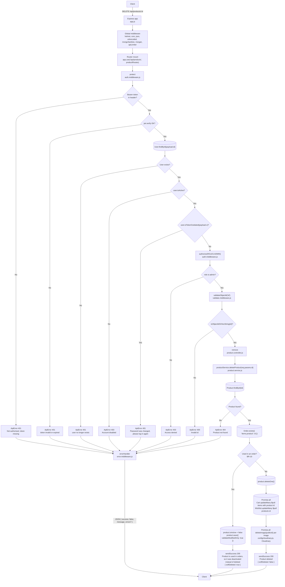

# Delete a product (admin) – `DELETE /api/products/:id`

An admin deletes a product. If any order contains it (BR-10), it is only hidden (`isActive = false`) so order history keeps its link. Otherwise it is really deleted, removed from every cart and wishlist, and its Cloudinary images are deleted. Only admins may call it.

**Files involved:** `server/src/app.js` (global middleware, mounts `/api/products`), `server/src/modules/products/product.routes.js` (route + middleware order), `server/src/middleware/auth.middleware.js` (`protect`, `authorize`), `server/src/middleware/validate.middleware.js` (`validateObjectId`), `server/src/modules/products/product.controller.js` (`remove`), `server/src/modules/products/product.service.js` (`deleteProduct`), `server/src/modules/orders/order.model.js` (`Order.exists` on `items.product`), `server/src/modules/cart/cart.model.js` + `server/src/modules/wishlist/wishlist.model.js` (`$pull` cleanup), `server/src/config/cloudinary.js` (`deleteImage`), `server/src/middleware/error.middleware.js` (error response).
