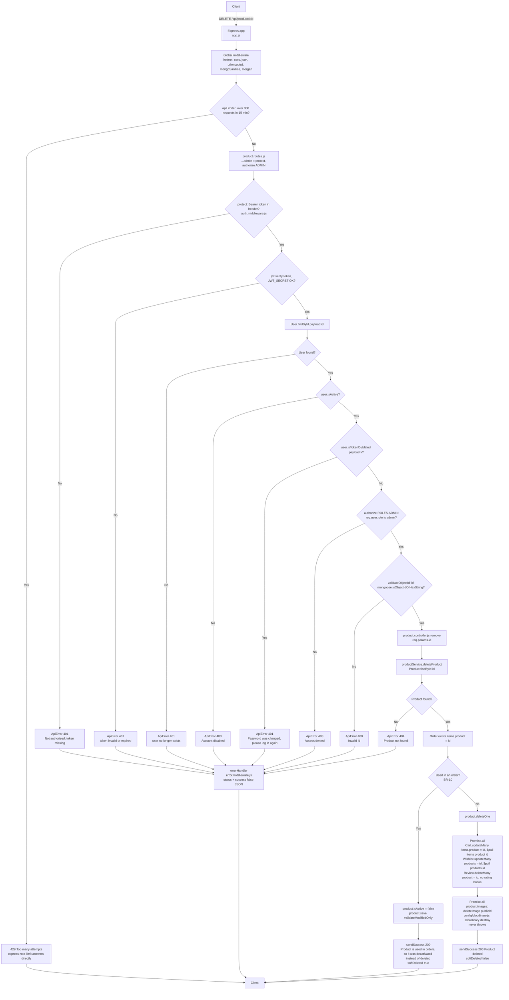

# Delete product – `DELETE /api/products/:id`

Admin-only. A product used in any order is only deactivated (BR-10, soft delete). Otherwise it is really deleted, removed from every cart and wishlist, and since branch 09 its reviews are deleted too (`Review.deleteMany`, which skips the rating hooks); its images are then deleted from Cloudinary.

**Files involved:** `server/src/app.js` (mounts /api/products, apiLimiter), `server/src/modules/products/product.routes.js` (admin guards, validateObjectId), `server/src/middleware/auth.middleware.js` (protect, authorize), `server/src/middleware/validate.middleware.js` (validateObjectId), `server/src/modules/products/product.controller.js` (remove), `server/src/modules/products/product.service.js` (deleteProduct), `server/src/modules/orders/order.model.js` (Order), `server/src/modules/cart/cart.model.js` (Cart), `server/src/modules/wishlist/wishlist.model.js` (Wishlist), `server/src/modules/reviews/review.model.js` (Review), `server/src/config/cloudinary.js` (deleteImage), `server/src/middleware/error.middleware.js` (errorHandler)
