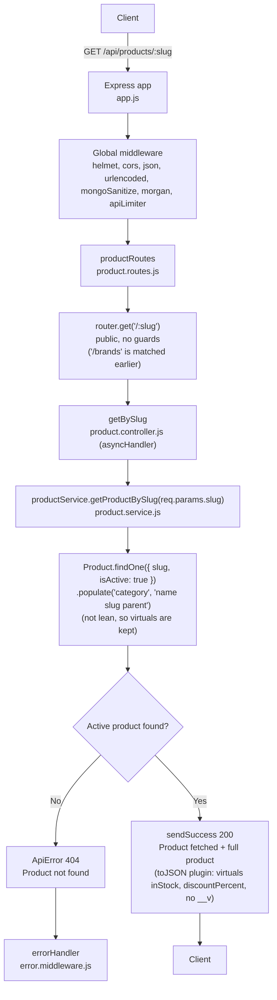

# Get product by slug – `GET /api/products/:slug`

Public endpoint (no token needed): one ACTIVE product by its slug, with its category's name, slug and parent. An inactive product answers 404 exactly like a missing one.

**Files involved:** `server/src/app.js` (mounts `/api/products`, global middleware), `server/src/modules/products/product.routes.js` (public `GET /:slug`), `server/src/modules/products/product.controller.js` (`getBySlug`), `server/src/modules/products/product.service.js` (`getProductBySlug`, `notFound`), `server/src/modules/products/product.model.js` (Product schema, `inStock` and `discountPercent` virtuals, `toJSON` plugin), `server/src/utils/ApiError.js` (404), `server/src/utils/ApiResponse.js` (`sendSuccess`), `server/src/middleware/error.middleware.js` (`errorHandler`).
