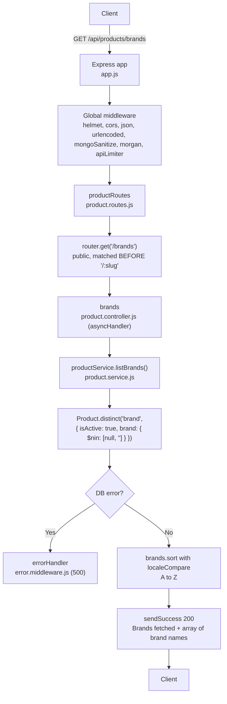

# List brands – `GET /api/products/brands`

Public endpoint (no token needed): every distinct brand used by an ACTIVE product, sorted A to Z, for the shop's brand filter. The `/brands` route is declared before `/:slug`, so "brands" is never treated as a product slug.

**Files involved:** `server/src/app.js` (mounts `/api/products`, global middleware), `server/src/modules/products/product.routes.js` (public `GET /brands`, ordered before `/:slug`), `server/src/modules/products/product.controller.js` (`brands`), `server/src/modules/products/product.service.js` (`listBrands`), `server/src/modules/products/product.model.js` (Product schema), `server/src/utils/ApiResponse.js` (`sendSuccess`), `server/src/middleware/error.middleware.js` (`errorHandler`).
