# List products – `GET /api/products`

Public endpoint (no token needed): the shop's product list. Only ACTIVE products, with optional filters (`keyword`, `category` slug, `minPrice`, `maxPrice`, `rating`, `inStock`, `isFeatured`, `brand`), a whitelisted `sort` and pagination (`page`, `limit`: default 12, max 48).

```mermaid
flowchart TD
    A[Client] -->|"GET /api/products?keyword&category&minPrice&maxPrice&rating&inStock&isFeatured&brand&sort&page&limit"| B[Express app<br/>app.js]
    B --> C[Global middleware<br/>helmet, cors, json, urlencoded, mongoSanitize, morgan, apiLimiter]
    C --> D[productRoutes<br/>product.routes.js]
    D --> E["router.get('/')<br/>public, no guards, no validation"]
    E --> F["list<br/>product.controller.js (asyncHandler)"]
    F --> G["productService.listProducts(req.query)<br/>product.service.js"]
    G --> H["getPagination(query, 12, 48)<br/>utils/pagination.js<br/>bad page/limit fall back to defaults, skip = (page - 1) x limit"]
    H --> I{"query.category is a<br/>non-empty string?"}
    I -->|No| J["categoryIds = null<br/>(any category)"]
    I -->|Yes| K["categoryIdsFromSlug(slug)<br/>Category.findOne({ slug, isActive: true }).select('_id').lean()"]
    K --> K1{Active category found?}
    K1 -->|No| K2["categoryIds = []<br/>(matches no products)"]
    K1 -->|Yes| K3["Category.find({ parent: category._id, isActive: true })<br/>.select('_id').lean()"]
    K3 --> K4["categoryIds = [category._id, ...children ids]"]
    J --> L
    K2 --> L
    K4 --> L
    L["buildProductFilter(query, categoryIds)<br/>product.query.js<br/>always isActive: true<br/>keyword: $text $search (max 100 chars)<br/>category: $in categoryIds<br/>minPrice/maxPrice: price $gte/$lte<br/>rating: ratingAverage $gte (capped at 5)<br/>inStock=true: stock $gt 0<br/>isFeatured=true: isFeatured true<br/>brand: escaped, case-insensitive exact regex<br/>anything else ignored"]
    L --> M["getSort(query.sort)<br/>product.query.js<br/>SORTS whitelist: newest, price_asc, price_desc, rating, popular<br/>unknown or missing = newest, _id tie-breaker"]
    M --> N["Promise.all<br/>Product.find(filter).select(CARD_FIELDS).sort().skip().limit().lean()<br/>+ Product.countDocuments(filter)"]
    N --> O{DB error?}
    O -->|Yes| EH["errorHandler<br/>error.middleware.js (500)"]
    O -->|No| P["buildMeta(page, limit, total)<br/>utils/pagination.js<br/>pages = ceil(total / limit), at least 1"]
    P --> Q["sendSuccess 200<br/>Products fetched + data: product cards + meta: page, limit, total, pages"]
    Q --> R[Client]
```

**Files involved:** `server/src/app.js` (mounts `/api/products`, global middleware), `server/src/modules/products/product.routes.js` (public `GET /`), `server/src/modules/products/product.controller.js` (`list`), `server/src/modules/products/product.service.js` (`listProducts`, `categoryIdsFromSlug`, `CARD_FIELDS`, `PUBLIC_PAGE`), `server/src/modules/products/product.query.js` (`buildProductFilter`, `getSort`, `SORTS`, `escapeRegex`), `server/src/utils/pagination.js` (`getPagination`, `buildMeta`), `server/src/modules/products/product.model.js` (Product schema, indexes, `product_text_search` text index), `server/src/modules/categories/category.model.js` (Category lookups), `server/src/utils/ApiResponse.js` (`sendSuccess` with `meta`), `server/src/middleware/error.middleware.js` (`errorHandler`).
