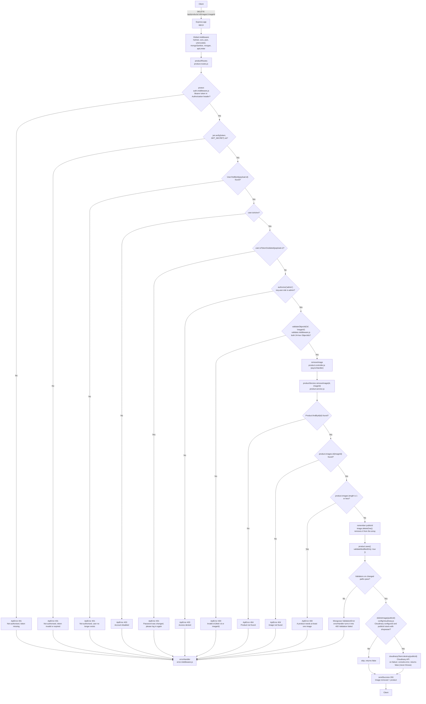

# Remove product image – `DELETE /api/products/:id/images/:imageId`

Admin only: removes ONE image (by its sub-document `_id`) from a product and then deletes the file from Cloudinary. A product must keep at least one image.

**Files involved:** `server/src/app.js` (mounts `/api/products`, global middleware), `server/src/modules/products/product.routes.js` (`DELETE /:id/images/:imageId` with `protect`, `authorize(ROLES.ADMIN)`, `validateObjectId('id', 'imageId')`), `server/src/middleware/auth.middleware.js` (`protect`, `authorize`), `server/src/middleware/validate.middleware.js` (`validateObjectId`), `server/src/modules/products/product.controller.js` (`removeImage`), `server/src/modules/products/product.service.js` (`removeImage`), `server/src/modules/products/product.model.js` (`images` sub-documents with `_id`), `server/src/db/schemas/image.schema.js` (image `{ _id, url, publicId }`), `server/src/config/cloudinary.js` (`deleteImage`, `cloudinaryClient.destroy`), `server/src/utils/ApiError.js`, `server/src/utils/ApiResponse.js` (`sendSuccess`), `server/src/middleware/error.middleware.js` (`errorHandler`).
