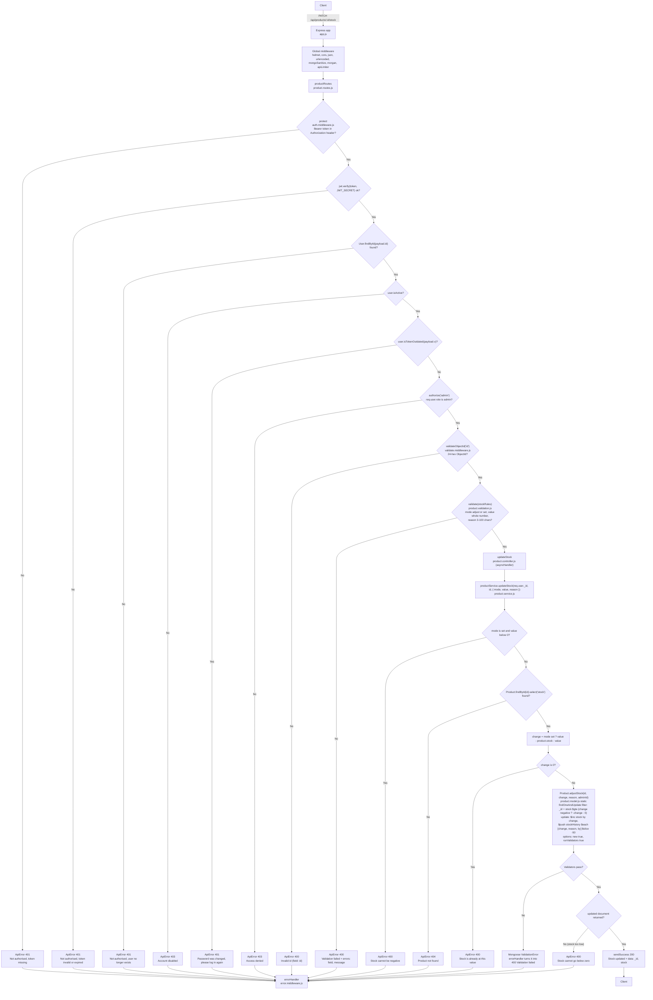

# Update product stock – `PATCH /api/products/:id/stock`

Admin only: a manual stock change with a reason, recorded in the product's stock history (last 50 kept). `mode: 'adjust'` sends a change (+20 / -3), `mode: 'set'` sends the new total; both become one atomic `$inc` that can never take the stock below zero.

**Files involved:** `server/src/app.js` (mounts `/api/products`, global middleware), `server/src/modules/products/product.routes.js` (`PATCH /:id/stock` with `protect`, `authorize(ROLES.ADMIN)`, `validateObjectId('id')`, `validate(stockRules)`), `server/src/middleware/auth.middleware.js` (`protect`, `authorize`), `server/src/middleware/validate.middleware.js` (`validateObjectId`, `validate`), `server/src/modules/products/product.validation.js` (`stockRules`), `server/src/modules/products/product.controller.js` (`updateStock`), `server/src/modules/products/product.service.js` (`updateStock`), `server/src/modules/products/product.model.js` (`adjustStock` static, `stockHistorySchema`), `server/src/config/constants.js` (`LIMITS.STOCK_HISTORY_KEEP`), `server/src/utils/ApiError.js`, `server/src/utils/ApiResponse.js` (`sendSuccess`), `server/src/middleware/error.middleware.js` (`errorHandler`).
