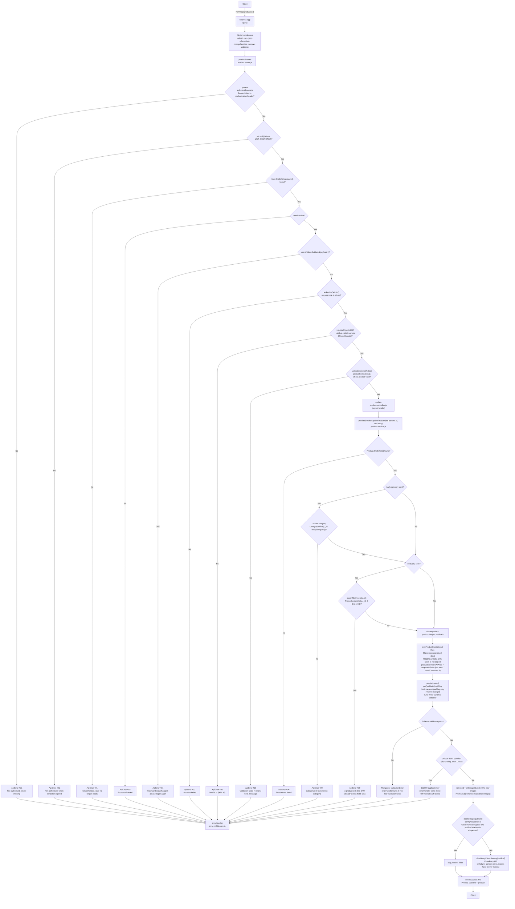

# Update product – `PUT /api/products/:id`

Admin only: replaces a product's editable fields (the admin form sends the whole product). `stock` is ignored here (use `PATCH /api/products/:id/stock`). Renaming builds a new slug. Images that were removed from the product are deleted from Cloudinary, but only after the save worked.

**Files involved:** `server/src/app.js` (mounts `/api/products`, global middleware), `server/src/modules/products/product.routes.js` (`PUT /:id` with `protect`, `authorize(ROLES.ADMIN)`, `validateObjectId('id')`, `validate(productRules)`), `server/src/middleware/auth.middleware.js` (`protect`, `authorize`), `server/src/middleware/validate.middleware.js` (`validateObjectId`, `validate`), `server/src/modules/products/product.validation.js` (`productRules`), `server/src/modules/products/product.controller.js` (`update`), `server/src/modules/products/product.service.js` (`updateProduct`, `assertCategory`, `assertSkuFree`, `pickProductFields`), `server/src/modules/products/product.model.js` (validators, `setSlug` hook), `server/src/db/utils/slugify.js` (`uniqueSlug`), `server/src/config/cloudinary.js` (`deleteImage`, `cloudinaryClient.destroy`), `server/src/utils/ApiError.js`, `server/src/utils/ApiResponse.js` (`sendSuccess`), `server/src/middleware/error.middleware.js` (`errorHandler`).
