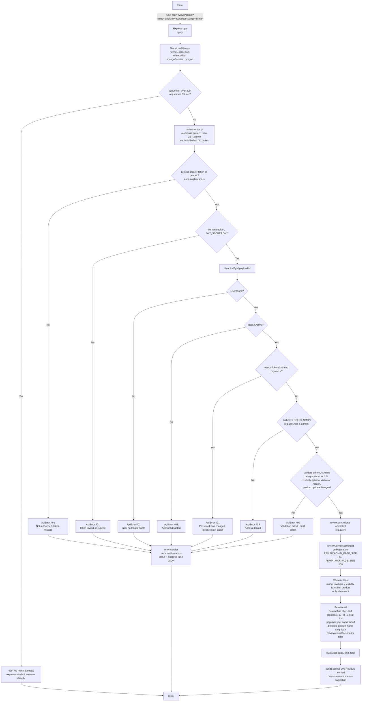

# Admin list reviews – `GET /api/reviews/admin`

Admin-only moderation list of EVERY review (visible and hidden), newest first, paginated (default 20, max 100), with optional filters `?rating=`, `?visibility=visible|hidden` and `?product=`. Reviewer name and email and the product name and slug are populated.

**Files involved:** `server/src/app.js` (mounts /api/reviews, apiLimiter), `server/src/modules/reviews/review.routes.js` (router.use protect, GET /admin), `server/src/middleware/auth.middleware.js` (protect, authorize), `server/src/middleware/validate.middleware.js` (validate), `server/src/modules/reviews/review.validation.js` (adminListRules), `server/src/modules/reviews/review.controller.js` (adminList), `server/src/modules/reviews/review.service.js` (adminList), `server/src/modules/reviews/review.model.js` (Review, index isVisible + rating + createdAt), `server/src/utils/pagination.js` (getPagination, buildMeta), `server/src/config/constants.js` (REVIEW, ROLES), `server/src/middleware/error.middleware.js` (errorHandler)
