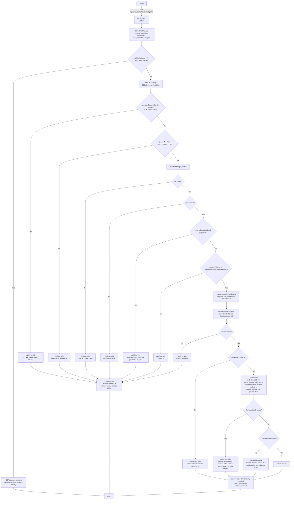

# Check review eligibility – `GET /api/products/:id/reviews/eligibility`

Any logged-in user asks "may I review this product?". It never throws for "not allowed": it answers `{ canReview, reason?, review? }` so the product page can show the form, an explanation, or "Edit your review".

**Files involved:** `server/src/app.js` (mounts /api/products, apiLimiter), `server/src/modules/products/product.routes.js` (nested GET /:id/reviews/eligibility), `server/src/middleware/auth.middleware.js` (protect), `server/src/middleware/validate.middleware.js` (validateObjectId), `server/src/modules/reviews/review.controller.js` (eligibility), `server/src/modules/reviews/review.service.js` (eligibility, assertProductExists, findDeliveredOrder), `server/src/modules/orders/order.model.js` (Order), `server/src/modules/reviews/review.model.js` (Review), `server/src/config/constants.js` (ROLES, ORDER_STATUS), `server/src/middleware/error.middleware.js` (errorHandler)
