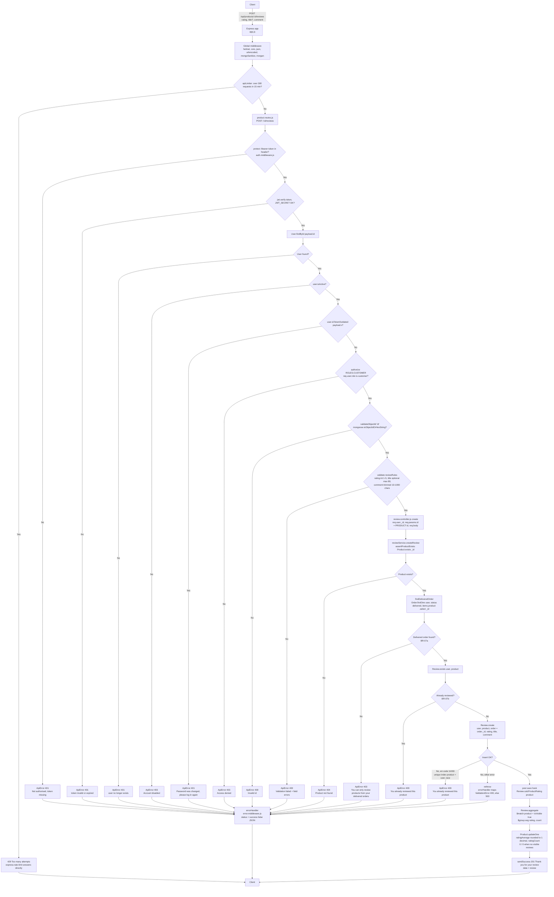

# Create review – `POST /api/products/:id/reviews`

A customer writes ONE review (rating 1–5, optional title, comment 10–1000 chars) for a product from one of their DELIVERED orders. The author, product and proof order come from the token, URL and database, never the body. A post-save hook recalculates the product's rating.

**Files involved:** `server/src/app.js` (mounts /api/products, apiLimiter), `server/src/modules/products/product.routes.js` (nested POST /:id/reviews), `server/src/middleware/auth.middleware.js` (protect, authorize), `server/src/middleware/validate.middleware.js` (validateObjectId, validate), `server/src/modules/reviews/review.validation.js` (reviewRules), `server/src/modules/reviews/review.controller.js` (create), `server/src/modules/reviews/review.service.js` (createReview, assertProductExists, findDeliveredOrder), `server/src/modules/orders/order.model.js` (Order), `server/src/modules/reviews/review.model.js` (Review, unique index one_review_per_product, post save hook, calcProductRating), `server/src/modules/products/product.model.js` (ratingAverage, ratingCount), `server/src/config/constants.js` (REVIEW, ROLES, ORDER_STATUS), `server/src/middleware/error.middleware.js` (errorHandler)
