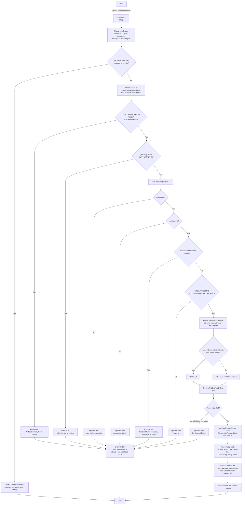

# Delete review – `DELETE /api/reviews/:id`

Any logged-in user may call it: a customer deletes only their own review (someone else's answers 404), an admin may delete any review. A post findOneAndDelete hook recalculates the product's rating.

**Files involved:** `server/src/app.js` (mounts /api/reviews, apiLimiter), `server/src/modules/reviews/review.routes.js` (router.use protect, DELETE /:id), `server/src/middleware/auth.middleware.js` (protect), `server/src/middleware/validate.middleware.js` (validateObjectId), `server/src/modules/reviews/review.controller.js` (remove), `server/src/modules/reviews/review.service.js` (deleteReview), `server/src/modules/reviews/review.model.js` (Review, post findOneAndDelete hook, calcProductRating), `server/src/modules/products/product.model.js` (ratingAverage, ratingCount), `server/src/config/constants.js` (ROLES), `server/src/middleware/error.middleware.js` (errorHandler)
