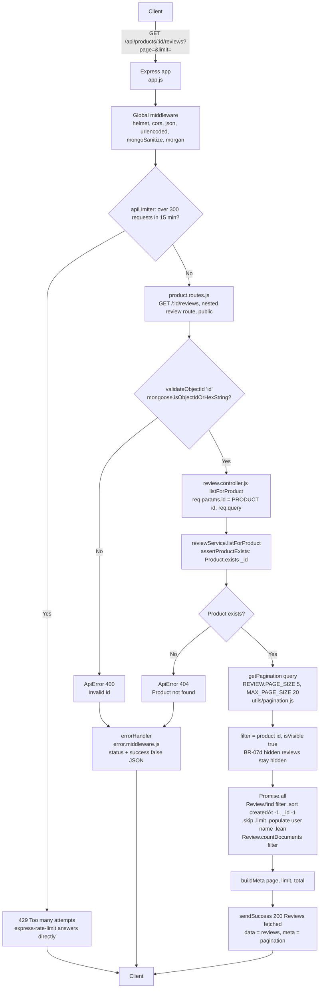

# List product reviews – `GET /api/products/:id/reviews`

Public (no login) list of the VISIBLE reviews of one product, newest first and paginated (default 5 per page, max 20). Reviewer names are shown, emails never are.

**Files involved:** `server/src/app.js` (mounts /api/products, apiLimiter), `server/src/modules/products/product.routes.js` (nested GET /:id/reviews), `server/src/middleware/validate.middleware.js` (validateObjectId), `server/src/modules/reviews/review.controller.js` (listForProduct), `server/src/modules/reviews/review.service.js` (listForProduct, assertProductExists), `server/src/modules/reviews/review.model.js` (Review, index product + isVisible + createdAt), `server/src/utils/pagination.js` (getPagination, buildMeta), `server/src/config/constants.js` (REVIEW), `server/src/middleware/error.middleware.js` (errorHandler)
