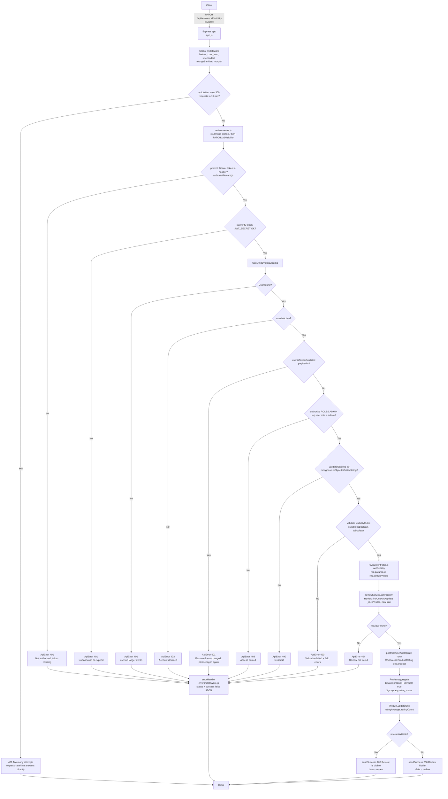

# Set review visibility – `PATCH /api/reviews/:id/visibility`

Admin-only moderation: hide or show a review (`isVisible: true | false`). Hidden reviews keep their data but vanish from the public list and from the product's average; a post findOneAndUpdate hook recalculates the rating.

**Files involved:** `server/src/app.js` (mounts /api/reviews, apiLimiter), `server/src/modules/reviews/review.routes.js` (router.use protect, PATCH /:id/visibility), `server/src/middleware/auth.middleware.js` (protect, authorize), `server/src/middleware/validate.middleware.js` (validateObjectId, validate), `server/src/modules/reviews/review.validation.js` (visibilityRules), `server/src/modules/reviews/review.controller.js` (setVisibility), `server/src/modules/reviews/review.service.js` (setVisibility), `server/src/modules/reviews/review.model.js` (Review, post findOneAndUpdate hook, calcProductRating), `server/src/modules/products/product.model.js` (ratingAverage, ratingCount), `server/src/middleware/error.middleware.js` (errorHandler)
