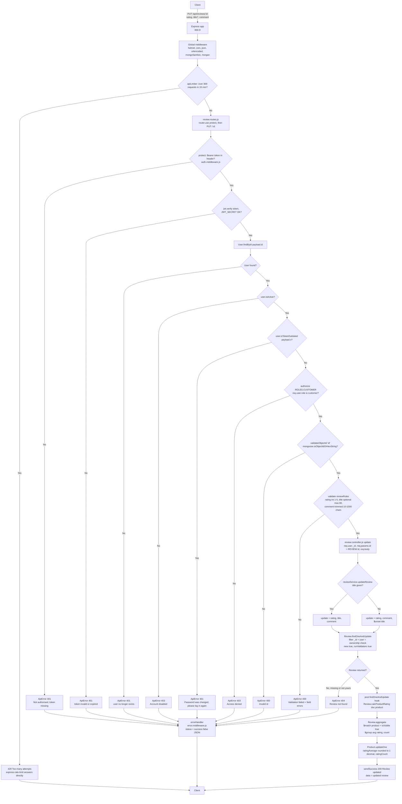

# Update review – `PUT /api/reviews/:id`

The author (customer only) replaces their own review's rating, title and comment. Someone else's review id answers the same 404 as a missing one. An empty title removes the headline. A post findOneAndUpdate hook recalculates the product's rating.

**Files involved:** `server/src/app.js` (mounts /api/reviews, apiLimiter), `server/src/modules/reviews/review.routes.js` (router.use protect, PUT /:id), `server/src/middleware/auth.middleware.js` (protect, authorize), `server/src/middleware/validate.middleware.js` (validateObjectId, validate), `server/src/modules/reviews/review.validation.js` (reviewRules), `server/src/modules/reviews/review.controller.js` (update), `server/src/modules/reviews/review.service.js` (updateReview), `server/src/modules/reviews/review.model.js` (Review, post findOneAndUpdate hook, calcProductRating), `server/src/modules/products/product.model.js` (ratingAverage, ratingCount), `server/src/middleware/error.middleware.js` (errorHandler)
