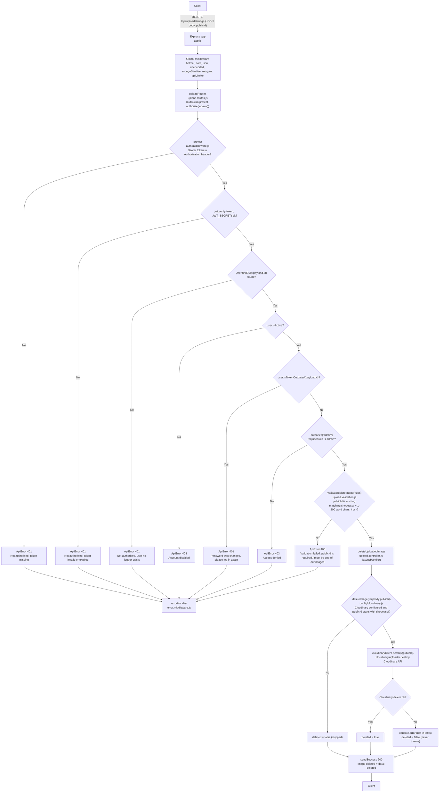

# Delete uploaded image – `DELETE /api/uploads/image`

Admin only: deletes a freshly uploaded picture from Cloudinary (e.g. the admin removes it from the form before saving), so unused files do not stay on Cloudinary forever. Only our own files (`publicId` starting with `shopease/`) can be deleted. Answers `{ deleted }`: false when Cloudinary is not configured or the delete failed.

**Files involved:** `server/src/app.js` (mounts `/api/uploads`, global middleware), `server/src/modules/uploads/upload.routes.js` (`router.use(protect, authorize(ROLES.ADMIN))`, `DELETE /image` with `validate(deleteImageRules)`), `server/src/middleware/auth.middleware.js` (`protect`, `authorize`), `server/src/middleware/validate.middleware.js` (`validate`), `server/src/modules/uploads/upload.validation.js` (`deleteImageRules`), `server/src/modules/uploads/upload.controller.js` (`deleteUploadedImage`), `server/src/config/cloudinary.js` (`deleteImage`, `cloudinaryClient.isConfigured`, `cloudinaryClient.destroy`), `server/src/utils/ApiResponse.js` (`sendSuccess`), `server/src/middleware/error.middleware.js` (`errorHandler`).
