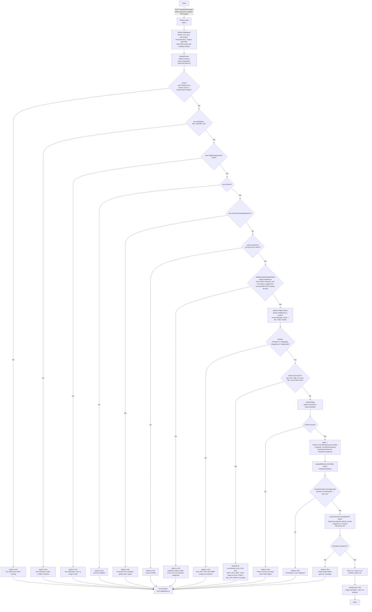

# Upload image – `POST /api/uploads/image`

Admin only: receives ONE image as `multipart/form-data` (form field `image`, JPG/PNG/WEBP, max 2 MB), streams it from memory to Cloudinary and returns `{ url, publicId }`, which the admin form then sends in a product or category body. Optional `?folder=products|categories` (default `products`).

**Files involved:** `server/src/app.js` (mounts `/api/uploads`, global middleware), `server/src/modules/uploads/upload.routes.js` (`router.use(protect, authorize(ROLES.ADMIN))`, `POST /image` with `validate(uploadImageRules)` then `upload.single('image')`), `server/src/middleware/auth.middleware.js` (`protect`, `authorize`), `server/src/middleware/validate.middleware.js` (`validate`), `server/src/modules/uploads/upload.validation.js` (`uploadImageRules`), `server/src/middleware/upload.middleware.js` (multer: memory storage, limits, `fileFilter`), `server/src/config/constants.js` (`LIMITS.MAX_IMAGE_BYTES`, `IMAGE_MIME_TYPES`), `server/src/modules/uploads/upload.controller.js` (`uploadImage`), `server/src/config/cloudinary.js` (`IMAGE_FOLDERS`, `uploadBuffer`, `cloudinaryClient.isConfigured`, `cloudinaryClient.upload`), `server/src/utils/ApiError.js`, `server/src/utils/ApiResponse.js` (`sendSuccess`), `server/src/middleware/error.middleware.js` (`errorHandler`, `MulterError` branch).
