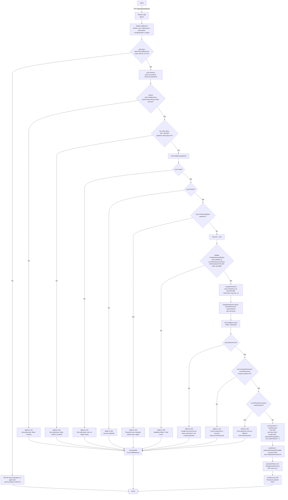

# Change password – `PUT /api/users/password`

Lets a logged-in user change their password after proving the current one. Old tokens stop working, so the response carries a fresh JWT; a security notice is emailed.

**Files involved:** `server/src/app.js` (global middleware, mounts `/api/users`), `server/src/middleware/rateLimit.middleware.js` (apiLimiter), `server/src/modules/users/user.routes.js` (router.use(protect), route pipeline), `server/src/middleware/auth.middleware.js` (protect), `server/src/middleware/validate.middleware.js` (runs rules), `server/src/modules/users/user.validation.js` (changePasswordRules, reuses passwordRule from `auth.validation.js`), `server/src/modules/users/user.controller.js` (changePassword), `server/src/modules/users/user.service.js` (changePassword), `server/src/modules/users/user.model.js` (comparePassword, pre-save hash, tokenVersion), `server/src/emails/sendEmail.js` + `server/src/emails/templates.js` (password changed notice), `server/src/utils/generateToken.js` (fresh JWT), `server/src/utils/ApiResponse.js` (sendSuccess), `server/src/utils/ApiError.js`, `server/src/middleware/error.middleware.js` (error JSON).
