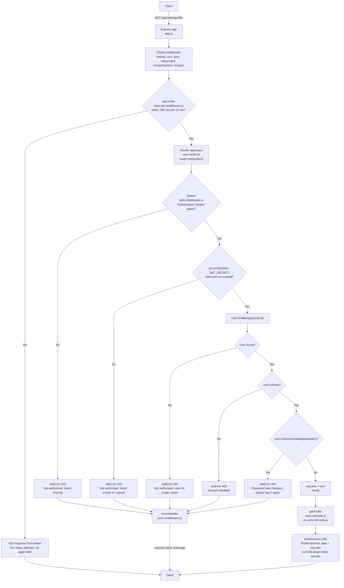

# Get my profile – `GET /api/users/profile`

Returns the logged-in user's own profile. Any logged-in user (customer or admin) may call it; there is no `:id`, the user always comes from the token.

**Files involved:** `server/src/app.js` (global middleware, mounts `/api/users`), `server/src/middleware/rateLimit.middleware.js` (`apiLimiter`), `server/src/modules/users/user.routes.js` (`router.use(protect)`, `GET /profile`), `server/src/middleware/auth.middleware.js` (`protect`), `server/src/modules/users/user.controller.js` (`getProfile`), `server/src/utils/ApiResponse.js` (`sendSuccess`), `server/src/db/plugins/toJSON.js` (strips hidden fields), `server/src/middleware/error.middleware.js` (`errorHandler`).
