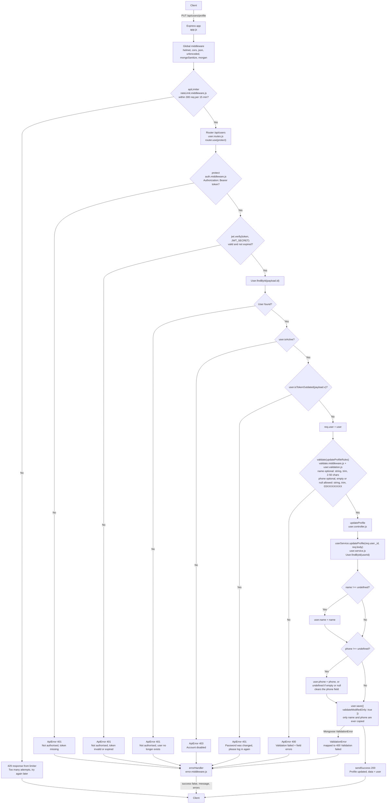

# Update my profile – `PUT /api/users/profile`

Partially updates the logged-in user's own `name` and/or `phone`. Any logged-in user (customer or admin) may call it; every other body field (role, email, isEmailVerified...) is ignored.

**Files involved:** `server/src/app.js` (global middleware, mounts `/api/users`), `server/src/middleware/rateLimit.middleware.js` (`apiLimiter`), `server/src/modules/users/user.routes.js` (`router.use(protect)`, `PUT /profile`), `server/src/middleware/auth.middleware.js` (`protect`), `server/src/middleware/validate.middleware.js` (`validate`), `server/src/modules/users/user.validation.js` (`updateProfileRules`), `server/src/config/constants.js` (`REGEX.PK_PHONE`), `server/src/modules/users/user.controller.js` (`updateProfile`), `server/src/modules/users/user.service.js` (`updateProfile`, mass-assignment protection), `server/src/modules/users/user.model.js` (new optional `phone` field), `server/src/utils/ApiResponse.js` (`sendSuccess`), `server/src/middleware/error.middleware.js` (`errorHandler`).
