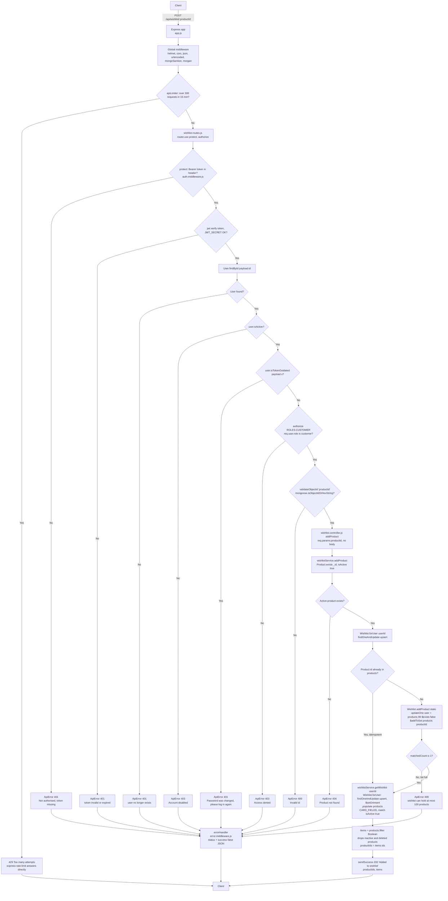

# Add product to wishlist – `POST /api/wishlist/:productId`

Saves an active product to the logged-in customer's wishlist. Adding a product that is already saved changes nothing (idempotent, still 200); a full list (100 products) is refused atomically. Customers only.

**Files involved:** `server/src/app.js` (mounts /api/wishlist, apiLimiter), `server/src/modules/wishlist/wishlist.routes.js` (protect + authorize customer for every route), `server/src/middleware/auth.middleware.js` (protect, authorize), `server/src/middleware/validate.middleware.js` (validateObjectId), `server/src/modules/wishlist/wishlist.controller.js` (thin controller, sendSuccess), `server/src/modules/wishlist/wishlist.service.js` (business rules, getWishlist), `server/src/modules/wishlist/wishlist.model.js` (Wishlist schema, forUser upsert, addProduct, removeProduct statics), `server/src/middleware/error.middleware.js` (errorHandler), `server/src/config/constants.js` (LIMITS.MAX_WISHLIST)
