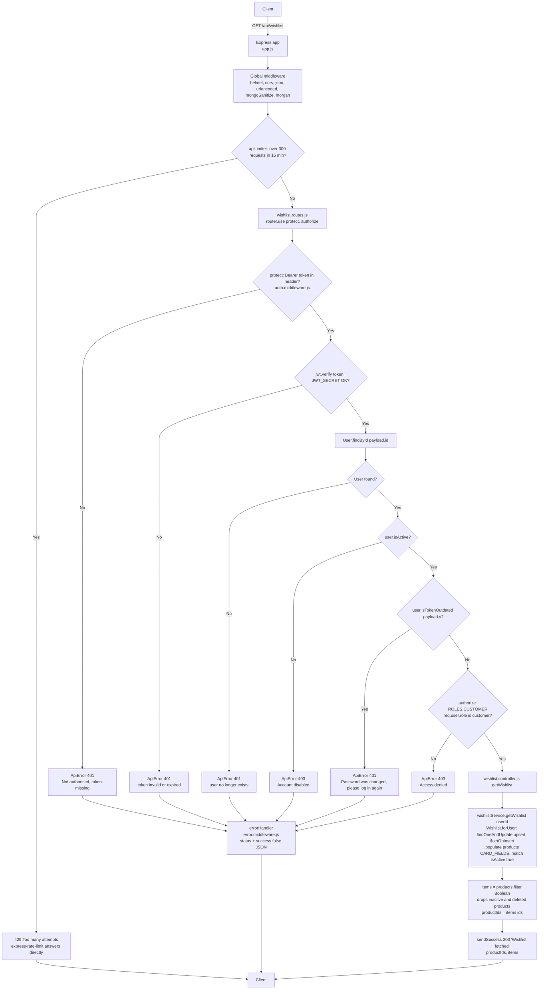

# Get my wishlist – `GET /api/wishlist`

Returns the logged-in customer's saved products as product cards plus a list of their ids; inactive or deleted products are left out. Customers only. The wishlist is created on the fly (upsert) if the account has none.

**Files involved:** `server/src/app.js` (mounts /api/wishlist, apiLimiter), `server/src/modules/wishlist/wishlist.routes.js` (protect + authorize customer for every route), `server/src/middleware/auth.middleware.js` (protect, authorize), `server/src/modules/wishlist/wishlist.controller.js` (thin controller, sendSuccess), `server/src/modules/wishlist/wishlist.service.js` (business rules, getWishlist), `server/src/modules/wishlist/wishlist.model.js` (Wishlist schema, forUser upsert, addProduct, removeProduct statics), `server/src/middleware/error.middleware.js` (errorHandler)
