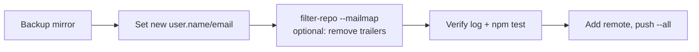

# Changing the commit author (before the first push)

All commits in this repo were made **locally** with the git identity configured on this computer. Each commit stores:

- **Author**: who wrote the change
- **Committer**: who saved it into the history

Each is a `Name <email>` pair. If you want the history to show a **different account** (e.g. another GitHub account), rewrite it **before you push for the first time**. Rewriting after pushing forces everyone who cloned the repo to start over.

> ⚠️ Rewriting history creates **new commit ids** for every commit. That's fine for a repo nobody else has cloned yet.

Placeholders used below:
- old identity: `OLD NAME <old@email>`
- new identity: `NEW NAME <new@email>`

Use your real values when you run the commands.

---

## Step 0: back up

```bash
cd ..                                   # the folder that contains shopease-learning
git clone --mirror shopease-learning shopease-learning-backup.git
```

If anything goes wrong, you can clone from the backup.

## Step 1: set the NEW identity for future commits

Only for this repo (recommended):
```bash
cd shopease-learning
git config user.name  "NEW NAME"
git config user.email "new@email"
```

Or for every repo on this computer:
```bash
git config --global user.name  "NEW NAME"
git config --global user.email "new@email"
```

Check: `git config user.name` and `git config user.email`.

> For GitHub to link commits to your account, the email must be one of the account's verified emails, or its `ID+username@users.noreply.github.com` address (GitHub → Settings → Emails).

## Step 2: see who is in the history now

```bash
git log --all --format='%an <%ae> | %cn <%ce>' | sort | uniq -c
```

---

## Option A (recommended): `git filter-repo` with a mailmap

`git filter-repo` is the tool the Git project recommends for rewriting history. It rewrites **all branches and tags at once**, so the stacked branches stay connected.

### Install
```bash
pip install git-filter-repo          # needs Python 3
git filter-repo --version
```
(Windows alternative: `py -m pip install git-filter-repo`.)

### Create a mailmap file
Save as `../authors.mailmap` (outside the repo):
```
NEW NAME <new@email> OLD NAME <old@email>
```
Format: `correct identity` followed by `identity to replace`. Add one line per old identity if there are several.

### Rewrite every branch
```bash
git filter-repo --mailmap ../authors.mailmap --force
```
- By default it processes **all refs** (every branch and tag).
- `--force` is needed because the repo is not a fresh clone.
- It rewrites both author and committer.

### Verify
```bash
git log --all --format='%an <%ae> | %cn <%ce>' | sort | uniq -c
git branch -a                     # all stacked branches still there
git log --oneline --graph --all   # still stacked, one on top of the other
cd server && npm test             # code unchanged, tests still green
```

---

## Option B (not recommended here): rebase with `--reset-author`

```bash
git checkout main
git rebase -r --root --exec "git commit --amend --no-edit --reset-author"
```

This re-creates each commit on that **one branch** with your *current* `user.name`/`user.email`.

Why not here:
- You must repeat it on **every** stacked branch.
- After rewriting `main`, branch `02-…` still sits on the **old** `main` commits. The stack splits apart into duplicate histories.
- It's easy to end up with a tangled history.

Use it only for a repo with a single branch.

---

## The "Co-Authored-By" lines

Commit messages in this repo end with a trailer such as:
```
Co-Authored-By: Claude <noreply@anthropic.com>
```

GitHub shows such trailers as extra co-authors on the commit. You can:

**Keep them.** Do nothing. This honestly records that an AI assistant helped.

**Remove them** (rewrites messages on all branches):
```bash
git filter-repo --force --message-callback '
import re
return re.sub(rb"\n*Co-Authored-By: Claude[^\n]*\n?", b"\n", message).rstrip(b"\n") + b"\n"
'
```

You can combine both rewrites in one run:
```bash
git filter-repo --force --mailmap ../authors.mailmap --message-callback '...same as above...'
```

Verify:
```bash
git log --all --format='%H %s%n%b' | grep -i "co-authored-by" || echo "none left"
```

---

## Step 3: connect GitHub and push everything

1. On GitHub: **New repository** → name it (e.g. `shopease-learning`) → **don't** add a README/licence (the repo already has history).
2. Then:
```bash
git remote add origin https://github.com/NEW-USERNAME/shopease-learning.git
# (filter-repo removes any existing 'origin'; that's expected)
git push --all origin       # every branch
git push --tags origin      # tags, if you created any
```
3. GitHub → **Actions**: the CI workflow starts running on the pushed branches.

If you're logged in with the wrong GitHub account, Git Credential Manager will ask, or clear the old credential first: Windows → **Credential Manager → Windows Credentials** → remove `git:https://github.com`.

## Summary


