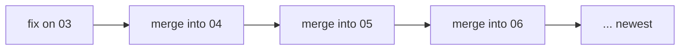

# Git workflow: stacked branches

## The model


- `main` = step 01 (auth).
- Each new branch is created **from the previous step's branch**, not from `main`.
- So `03-categories` contains 01 + 02 + 03. Modules that depend on earlier ones (products need categories) always have what they need.

## Creating the next step

```bash
git checkout 02-profile-addresses        # the latest step
git checkout -b 03-categories            # new branch on top of it
# ... build, test, commit in small steps ...
```

## Studying a step

```bash
git log --oneline --graph --all                     # the whole picture
git diff 02-profile-addresses..03-categories --stat # files changed by step 03
git diff 02-profile-addresses..03-categories -- server/src
git log --oneline 02-profile-addresses..03-categories   # step 03's commits, oldest last
git show <commit>                                    # one commit in detail
```

## Fixing a bug in an earlier step ("merge forward")

Say you find a bug in step 03 while working on step 06.

```bash
# 1) Fix it where it was born
git checkout 03-categories
# ...fix + test...
git commit -m "fix(categories): ..."

# 2) Carry the fix forward, one step at a time
git checkout 04-products-uploads && git merge 03-categories
git checkout 05-cart-wishlist     && git merge 04-products-uploads
git checkout 06-coupons           && git merge 05-cart-wishlist
# (continue up to the newest branch; run npm test after each merge)
```



If a merge has conflicts, git stops and marks them. Fix the files, `git add` them, then `git commit`.

## Why merge and never rebase here?

- **Rebase rewrites commits** (new ids). Every branch stacked on top would then point at old commits that no longer match, and you'd have to rebase the whole stack.
- **Merge keeps history** exactly as you studied it and records the fix as its own event.

So in this repo: `git merge` ✅, `git rebase` ❌ (on shared/stacked branches).

## Optional: tags

Mark finished steps so you can always find them:
```bash
git tag step-01 main
git tag step-02 02-profile-addresses
git checkout step-02     # read-only view of that moment
```

## Commit messages

We use a light form of **Conventional Commits**: `type(scope): summary`

| type | for |
|---|---|
| `feat` | new feature |
| `fix` | bug fix |
| `test` | tests only |
| `docs` | documentation |
| `chore` | tooling, config |
| `refactor` | code change without behaviour change |

Example: `feat(auth): add tokenVersion to revoke old tokens`.

## The pre-commit hook

Every `git commit` first runs lint-staged and the whole test suite (Husky). A red test cancels the commit. That's on purpose.

Before pushing to GitHub for the first time, read [changing-commit-author.md](changing-commit-author.md).
