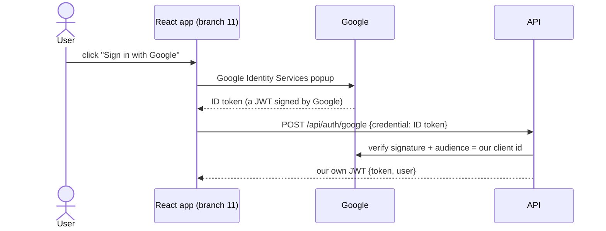

# Google login setup (optional)

Google sign-in is **off** while `GOOGLE_CLIENT_ID` is empty (the API answers 500 "Google login is not configured"). Everything else works without it.

## How it works

The backend only needs the **client id**, which it uses to check that the token was made for *our* app (`audience`).

## Create the client id
1. https://console.cloud.google.com → create/select a project.
2. **APIs & Services → OAuth consent screen**: External, app name, support email, save.
3. **APIs & Services → Credentials → Create credentials → OAuth client ID**
   - Application type: **Web application**
   - **Authorized JavaScript origins**: `http://localhost:5173` (and later your live frontend URL)
4. Copy the **Client ID** (`…apps.googleusercontent.com`).

## Configure
- `server/.env` → `GOOGLE_CLIENT_ID=…apps.googleusercontent.com`
- Later, `client/.env` → `VITE_GOOGLE_CLIENT_ID=` (the same value)

## Testing without a browser
Getting a real ID token needs the frontend. That's why our automated tests replace `googleVerifier.verify` with a stub (`tests/integration/google.test.js`) and cover every branch of the logic.
