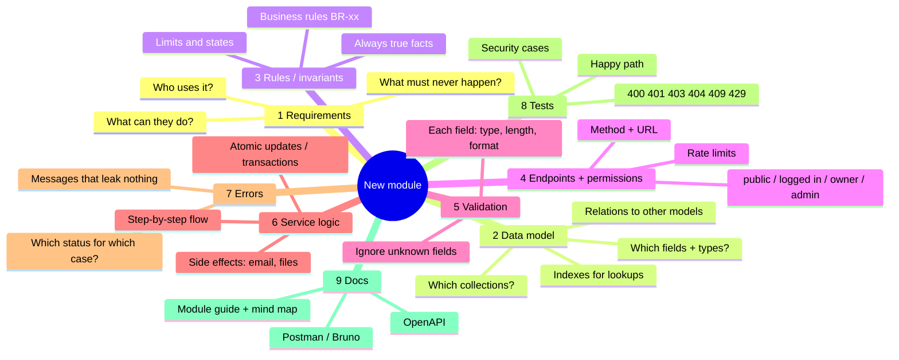
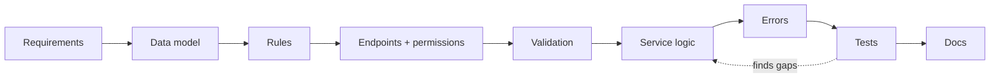

# How to think about ANY module

Before writing code, think in this order. Each step feeds the next. Every module in this repo was built this way, and every module mind map follows these headings.

## The flow

Tests often send you **back** to the service. That's normal and good.

## Questions to ask at each step

### 1. Requirements
- [ ] Who are the **actors**? (guest, customer, admin)
- [ ] What are the **use cases**, written as "As a ___ I can ___"?
- [ ] What must **never** happen? (e.g. "a customer sees another customer's address")

### 2. Data model
- [ ] What do I store, and what can I **calculate** instead?
- [ ] Which fields are **required**? Which are **secret** (`select: false`)?
- [ ] What links to what (ObjectId references)? Do I **copy** data (snapshot) or **reference** it?
- [ ] What will I **search by**? → indexes. What must be **unique**? → unique index.

### 3. Rules (invariants)
- [ ] What is always true? ("max 5 addresses", "exactly one default address")
- [ ] Which rules need the **database** to enforce them (unique index, atomic update)?
- [ ] Can two requests at the same time break a rule (a **race condition**)?

### 4. Endpoints and permissions
- [ ] Which URL and method for each use case (REST nouns)?
- [ ] For each: public, logged in, **owner only**, or admin?
- [ ] Does any route need a rate limit (logins, emails, expensive work)?

### 5. Validation
- [ ] For each input field: type, required, min/max, format.
- [ ] Which fields must the client **never** set (role, prices, ownerId)?

### 6. Service logic
- [ ] Write the steps in plain words first, then code.
- [ ] Which writes must succeed **together** (transaction)?
- [ ] What happens **after** the main work (emails)? Can it fail safely?

### 7. Errors
- [ ] For each "no" path: which status (400/401/403/404/409)?
- [ ] Does the message leak information (e.g. "this email exists")?

### 8. Tests
- [ ] One happy path per endpoint.
- [ ] Every error status from step 7.
- [ ] Permission tests: no token, wrong role, someone else's data.
- [ ] Edge cases: limits, duplicates, expired things, concurrency.

### 9. Docs
- [ ] OpenAPI entry for every route (a test checks this).
- [ ] Postman + Bruno requests with assertions.
- [ ] Module guide + mind map + changelog entry.

## Golden rules
1. **The server decides.** Never trust input; identity comes from the token.
2. **Fail early.** Validate at the edge and stop bad requests before the service.
3. **One job per layer.** Routes → middleware → controller → service → model.
4. **The database is the final guard.** Use unique indexes and atomic updates for rules that matter.
5. **If it isn't tested, it's broken.** You just don't know it yet.
