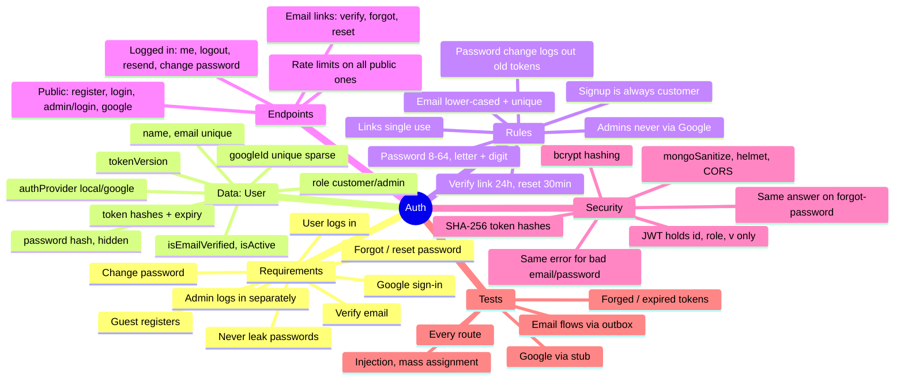

# Mind map – 01 Auth

## Thinking steps (how this module was reasoned out)

1. **Who and what?** Guests become customers. Customers and admins log in. Admins are special: nobody may *become* one through the API.
2. **What do we store?** One `User` document. The password can't be stored readably, so we store a **bcrypt hash**. Email links need a secret token, and we store its **SHA-256 hash** plus an expiry.
3. **How does the server remember a login?** HTTP is stateless. Options: sessions or tokens. We chose a **JWT**, so any server copy can check it without a session store.
4. **What can go wrong?**
   - Guessing passwords → **rate limits**.
   - Finding which emails exist → **identical messages**.
   - Registering as admin → the service **forces** `role: 'customer'`.
   - A stolen token after a password change → **tokenVersion**.
   - `{"$ne": null}` tricks → **sanitize + validate**.
5. **Guards as middleware.** `protect` answers "who?" and `authorize()` answers "allowed?". Every later module reuses them.
6. **Emails are side effects.** Send them *after* the database work succeeds, and never let an email failure break the request.
7. **Make it testable.** External services sit behind small boundaries (Google verifier, email outbox), so tests run offline.

## Decision log

| Decision | Why | Trade-off |
|---|---|---|
| JWT instead of server sessions | Stateless, so it scales and works on serverless | Logout can't kill a token server-side. Mitigated with short expiry + tokenVersion |
| JWT payload = `id`, `role`, `v` only | A JWT is readable by anyone | Must load the user from the DB on each request (also lets us check `isActive`) |
| `protect` reloads the user | Catches deleted/disabled users and outdated tokens | One DB read per request |
| bcrypt cost 10 | Slow for attackers, fine for login | ~50–100 ms per login |
| SHA-256 for email/reset tokens | Tokens are random and long; a fast hash allows lookup by hash | None in practice |
| Store token **hashes**, email the plain token | A DB leak can't be used to reset passwords | Can't re-send the same link, so we make a new one |
| Same 401 for unknown email / wrong password | Prevents user enumeration | Slightly less helpful message |
| Forgot-password always answers 200 | Prevents enumeration | User gets no "no such account" hint |
| `tokenVersion` counter (not timestamps) | Exact, no clock-precision gap ([the bug](../concepts/05-jwt-and-sessions.md#the-bug-story-a-real-lesson)) | One extra field |
| Separate `/auth/admin/login` with 5/15min limit | Admin accounts are the biggest target | One more route |
| Admins can't use Google | Admin access stays on the strictest path | Admins must remember a password |
| Google verifier in its own file | Tests can stub it | One extra small file |
| Rate-limit store in memory | Simple, no Redis needed | Not shared across multiple servers |
| Email failures logged, not thrown | Registration shouldn't fail because SMTP is down | User may need "resend verification" |

## Now read
- The module guide: [docs/modules/01-auth.md](../modules/01-auth.md)
- Then the code in build order: `user.model.js` → `auth.validation.js` → `auth.service.js` → `auth.controller.js` → `auth.routes.js` → `app.js`
