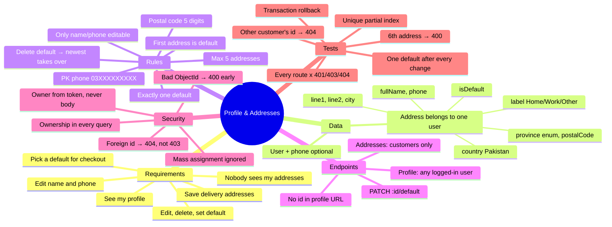

# Mind map – 02 Profile & Addresses

## Thinking steps (how this module was reasoned out)

1. **Who and what?** A logged-in user edits their own profile. A **customer** keeps a small address book for checkout. Admins have a profile, but no address book: they don't buy things.
2. **What do we store?**
   - The profile is the existing `User`, plus one optional field: `phone`.
   - An address is its **own collection**, not an array inside `User`. Reasons: it has its own id for the URLs, its own validation and indexes, and `protect` (which loads the user on *every* request) doesn't drag five addresses along each time.
3. **What must ALWAYS be true (invariants)?**
   - A customer has at most **5** addresses.
   - If a customer has addresses, **exactly one** is the default. So the first one becomes default, "set default" moves the flag in one step, and deleting the default promotes another one.
   - An address belongs to **one** user, and only that user can ever read or change it.
4. **How do we make "exactly one default" hold?** Three layers:
   - the **service** always unsets before it sets, inside a **transaction**, so a failure half-way changes nothing;
   - a **unique partial index** (`{user: 1}` unique, only where `isDefault: true`) makes two defaults impossible even if the code had a bug;
   - **tests** check the count of defaults after every operation.
5. **Who may call what?** Profile: anyone logged in (`protect`). Addresses: `protect` + `authorize('customer')`. Route guards can't know *whose* address `:id` is, so the **service** puts `user: req.user._id` into every query.
6. **What can go wrong?**
   - Customer B guesses customer A's address id → **IDOR**. The owner goes in every filter, and a miss is a **404**.
   - Body contains `user`, `role`, `email`, `isActive` → **mass assignment**. We copy only allowed fields by name.
   - `:id` is `abc` → `validateObjectId` gives **400** before the database is touched.
   - Two "set default" calls at once → the transaction retries on conflict, and the unique index is the last line of defence.
7. **Make it testable.** Factories (`createAddress`, `validAddress`) build any state in one line, such as "already 5 addresses" or "A and B each have a default".

## Decision log

| Decision | Why | Trade-off |
|---|---|---|
| Addresses in their own collection | Own ids/URLs/indexes, `protect` stays light | One extra query to list them |
| Ownership checked in the **query** (`{_id, user}`) | One step, and it can't be forgotten between "find" and "check" | Every service function must remember the filter (tests guard it) |
| Foreign id → **404** (not 403) | Doesn't confirm that the id exists | Slightly less specific for debugging |
| Admins get 403 on `/api/addresses` | Address book is a customer feature; admin views come in branch 10 with their own routes | Admins can't test the feature with their own account |
| Max 5 checked in the service (count, then insert) | Simple and readable, with a clear 400 message | Two perfectly simultaneous creates could make 6. Acceptable for an address book; a hard limit would need a transaction or a counter |
| Default change in a **transaction** | Unset + set are all-or-nothing | Needs a replica set (Atlas and our tests have one) |
| Unique partial index for one default | Database-level guarantee | A rare race returns 409 instead of a nicer message |
| `isDefault: false` on update is ignored | Never leaves zero defaults | Customer must "set another as default" instead |
| PUT replaces the whole address (full rules) | The frontend form always sends every field | No partial address updates |
| Profile is a **partial** update (`name`, `phone` optional) | Change one thing without resending the rest | Must treat `undefined` (not sent) and `""` (clear it) differently |
| `phone: ""` or `null` clears the phone | A user must be able to remove optional data | One more branch in the service |
| `validateObjectId` uses `isObjectIdOrHexString` | `isValidObjectId` accepts any 12-character string | None |
| No avatar yet | Needs file uploads (branch 04) | Profile has no picture for now |

## Now read
- The module guide: [docs/modules/02-profile-addresses.md](../modules/02-profile-addresses.md)
- The concept: [14 – Ownership and IDOR](../concepts/14-authorization-ownership.md)
- Then the code in build order: `config/constants.js` → `middleware/validate.middleware.js` (`validateObjectId`) → `address.model.js` → `address.validation.js` → `address.service.js` → `address.controller.js` → `address.routes.js` → `app.js`
